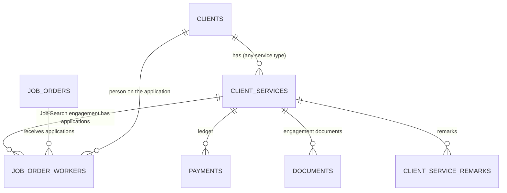
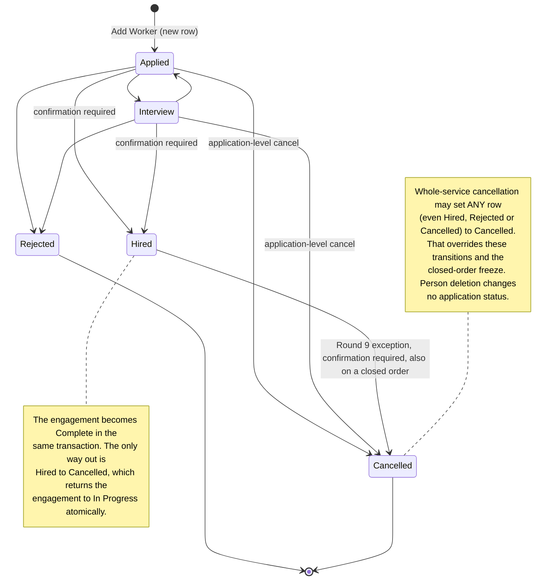
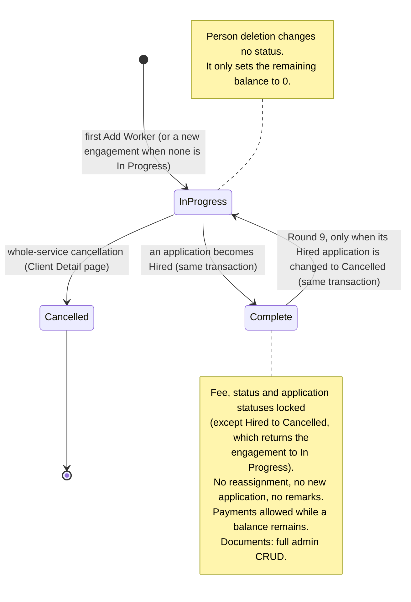

# Thai Visa Management Web App – High-Level Design (v0.9)

Status: **v0.9 (reconstructed), approved by the user on 2026-11-17. Round 9 and round 10 revisions (2026-11-17) are a DRAFT pending user review and are NOT approved.** · Stack: Laravel, Vue.js, Inertia.js, MySQL · Hosting: DigitalOcean Droplet · File storage: DigitalOcean Spaces (approved)

> **About this document.**
>
> - **This is not the original HLD v0.9.** The originally approved v0.9 could not be recovered from the repository or its Git history. This draft was rebuilt on 2026-11-16 from HLD v0.8 plus the decisions recovered in `docs/JOB_SEARCH_BUSINESS_RULES.md` and `docs/JOB_SEARCH_TECHNICAL_DECISIONS.md` (rounds 1–7). It was corrected on 2026-11-17:
>
>   - **Round 5:** the Person deletion cascade of rounds 3–4 is **revoked**.
>   - **Round 6:**
>     - Person deletion uses a **derived** remaining balance and also deletes the **profile photo**.
>     - The close **auto-cancels** soft-deleted Persons' open applications.
>     - **Application Activity is out of scope for V1.**
>   - **Round 7:** that auto-cancel removes the application's Job Order Money attribution, with the Kept Amount unchanged.
>
>   **Approved by the user on 2026-11-17.** HLD v0.8 was removed from the repository at the same time; it remains in Git history. Approval of this HLD is not approval to implement: each implementation step needs its own go-ahead.
> - **Round 9 (2026-11-17), DRAFT pending user review, not approved:** this document was revised to match the business rules approved in round 9.
>   - **Hired → Cancelled** is allowed (the only way out of Hired), with a mandatory confirmation, also on a closed Job Order. The ClientService returns from Complete to In Progress in the same transaction.
>   - **Job Order Money is live**, also after the order closes. **Unassigned Kept Amount** is a derived classification, not a transaction.
>   - The Hired Workers card counts current Hired applications only.
>   - Revision history: v0.9 reconstructed (rounds 1–8, approved 2026-11-17) → round 9 draft (this revision). The version number and file name are unchanged. The changed sections are 4.2, 4.7.2–4.7.7, 4.7.10, 4.12, 5, 7, 9.1, 11, 13 and 14, and every change is marked *Round 9* or sits in a paragraph that says so.
> - **Round 10 (2026-11-17), DRAFT pending user review, not approved:** the five open round 9 questions are decided.
>   - Hired → Cancelled is refused for a soft-deleted person and when the person has another In Progress engagement, and is an individual action only (not in bulk updates or the close modal).
>   - Unassigned Kept Amount is money retained by a Job Search engagement and not attributed to any Job Order; the dashboard shows it.
>   - The same person may be added to the same order again after their earlier application on it is terminal. The unique `(job_order_id, client_id)` key is removed, with no replacement index.
>   - The implementation was started in the working tree (uncommitted). The implementation-gap lists were refreshed.
> - **Phase 5 review (2026-11-19): decisions confirmed by the user, applied to this document.** Every change is marked *Phase 5* or sits in a paragraph that says so. Changed sections: 3.2, 3.3, 4.10, 4.11, 4.12, 12 (new 12.1–12.4: Phase 5 status, the 5a and 5d audit findings, the implementation plan (12.2: one sequential implementation table) and the questions that may arise during implementation; **planning only, pending user approval, not approval to implement**) and 13.1.
>   - **D1 Services Provided:** the implemented definition (every service record) is the approved one and replaces "number of available main services".
>   - **D2 Logos:** PNG, JPG/JPEG and WebP only; SVG is not allowed in V1, and no SVG sanitiser is used.
>   - **D3 Audit logs:** audit logs for settings and appearance changes are not required in V1 (Step 5e deferred).
>   - **D4 Before publishing:** the landing page keeps its structure, and unconfirmed or unavailable sections and content are hidden; mockup information is never shown as verified agency facts.
>   - **D5 Landing content:** mockup data may be used temporarily; the final system lets administrators manage agency content through CRUD; agency facts are never invented.
> - **HLD v1.0 was reviewed and is not approved.** Its correction items (U1–U4) are applied here.
> - **For Job Search,** the two `docs/` files are authoritative. Where this HLD and those files disagree, the files win.
> - **Everything not related to Job Search, Person deletion or concurrency is carried over from v0.8 unchanged.**
> - **Labels used in this document:**
>   - *Approved*: a recovered decision
>   - *Verified current code*: read from the code at commit `b7730dd`
>   - *Recommendation, pending approval*: not decided
>   - *Open*: undecided
> - **Approved rules are not implementation status.** Much of the Job Search design here is not built yet (Section 13.3).

## 1. Purpose and Scope

A web app for a visa-services agency in Thailand to manage clients, the services each client buys, payments, and documents. Clients get a simple read-only portal to track progress and download their own documents. The admin also manages Job Search (company hiring requests and the workers matched to them).

**In scope:** admin back office, client tracking portal with tracking link and QR code, service catalog with optional sub-services, payments and profit reporting (profit = received money), Work Permit document delivery, Job Search module, a public landing page, English and Burmese UI.

**Out of scope (v1):** online payment gateway, automated LINE/SMS notifications, additional staff roles (planned for version 2), mobile native apps. These can be added later (see Section 12).

## 2. Users and Roles

| Role | Authentication | Capabilities |
| --- | --- | --- |
| Admin | Email + password, or Google sign-in | Full access: clients, services, payments, documents, job search, dashboard, settings |
| Client | Tracking link or QR code (unique token) + 4-digit PIN (last 4 digits of phone) | Read own profile and service status; view and download own documents when permitted; switch UI language |
| Public visitor | None (no login) | View the public landing page only; no access to admin features or client data |

v1 has two roles: admin (full permission) and client (read and download their own data only). The `users` table keeps a `role` column so more roles can be added in version 2; they are not part of v1.

## 3. System Architecture

```
Browser (Vue 3 + Inertia pages, English / Burmese UI)
        |  HTTPS
DigitalOcean Droplet (client's DigitalOcean account)
   Laravel app (routes, controllers, policies, services, jobs)
   |-- MySQL  (on the same Droplet)
   |-- Queue + scheduler (reports; database driver, no Redis in the MVP)
   |-- Google OAuth (admin sign-in)
   |
   |  S3-compatible API (private access keys from .env)
DigitalOcean Spaces - approved, separate resource, client's account
   private bucket: user photos, PDF documents
   public bucket: website logo, favicon, hero image
```

**Key choices**

- **Inertia.js monolith:** Laravel controllers return Vue pages directly. No separate REST API is needed for v1, which keeps auth, validation and policies in one place.
- **Private object storage (DigitalOcean Spaces, approved):** no public objects. Files are reached only after Laravel checks permissions (Section 3.1).
- **Laravel Socialite** for Google sign-in; **Laravel Policies** for authorization; **Form Requests** for validation.
- **Money** stored as integers (satang) or `DECIMAL(12,2)`, never floats. Currency is THB.
- **Localization:** Laravel language files and vue-i18n provide the English and Burmese UI (Section 4.9).

### 3.1 File Storage (DigitalOcean Spaces – approved)

DigitalOcean Spaces is **approved by the client** as the file storage provider. It replaces the AWS S3 option in the earlier draft. Spaces is S3-compatible, so Laravel uses its standard S3 filesystem driver pointed at the Spaces endpoint. Hosting (Droplet) and storage (Spaces) are separate resources with separate cost estimates (Section 10.1).

| Topic | Design |
| --- | --- |
| Provider | DigitalOcean Spaces (S3-compatible object storage) |
| Environments | Development uses the Laravel local filesystem disk on the developer machine, so no cloud account is needed. Production uses DigitalOcean Spaces. The disk is chosen by an environment variable, the application code is the same, and the database stores the same relative key in both. In development, private files are served through a permission-checked Laravel route and public website images from the local public disk. This is server-side file storage; the browser localStorage is used only to remember the selected language (Section 4.9). |
| File types | User photos and PDF documents (private bucket), plus the website logo, favicon and hero image (separate public bucket, Section 4.11) |
| Storage access | Private by default. Public access must not be enabled for private documents: no public-read ACLs, and no CDN on private files. The only exception is a separate public bucket that holds the website logo, favicon and hero image (Section 4.11) |
| Authorization | Laravel verifies permissions before any private file is accessed. Admin has full access; a client reaches only files on their own record (never Job Search documents), and Work Permit documents only when the record is Fully Paid or the admin has released that document (release does not depend on payment status) |
| File delivery | Short-lived signed URL (option B, selected): Laravel checks permissions first, then redirects to a signed Spaces URL that expires within minutes |
| Configuration | Access keys, bucket name, region and endpoint are kept in environment variables and never committed to Git; the repository holds only a `.env.example` with variable names |
| Ownership | Production infrastructure and billing belong to the client's DigitalOcean account |

| Delivery option | How it works | Trade-off |
| --- | --- | --- |
| A. Laravel-controlled download | Laravel checks permission, reads the file from Spaces and streams it to the user | Strongest control and simple audit trail; file traffic passes through the Droplet |
| B. Short-lived signed URL | Laravel checks permission, then redirects to a signed Spaces URL that expires within minutes | Less load on the Droplet; the URL works for anyone holding it until it expires |

Option B (short-lived signed URL) was selected; option A is kept for reference.

### 3.2 Image and Document Upload Rules

| File | Accepted formats | Size limit | Notes |
| --- | --- | --- | --- |
| Website logo | PNG, JPG, WebP | 2 MB | Public bucket; required; *Phase 5 (D2):* SVG is not allowed in V1 |
| Favicon | PNG, ICO | 2 MB | Public bucket; required |
| Hero image | JPG, PNG, WebP | 2 MB | Public bucket; optional, the area is left blank if absent |
| Profile photo | JPG only | 2 MB | Private bucket; a user icon is shown if absent |
| Other advertising images | To be defined when added | 2 MB | Public bucket; the image area is left blank if absent |
| PDF documents | PDF | Maximum 5 MB | Private bucket |

- All photo and image files must not exceed 2 MB. The browser reduces images before upload (Section 3.3).
- File type and size are validated in the browser and again on the server; the server check always applies.
- *Phase 5 (D2):* SVG files are not accepted anywhere in V1, so no SVG sanitiser is used. (Superseded: "SVG files are sanitized before they are stored and displayed.")
- Public website assets live in a separate public bucket. Client profile photos and private documents stay in private storage, apart from the public assets.
- The database stores object keys, never the uploaded image files.

### 3.3 Frontend Image Size Reduction

Images are reduced in the browser before they are uploaded, so large photos from a phone camera do not fail the 2 MB limit and storage and page loading stay light. Uploads are made by the admin only.

| File | Processing in the browser |
| --- | --- |
| Profile photo | Resized and re-encoded as JPG (the only accepted format) to 2 MB or less |
| Logo (PNG, JPG, WebP) | Resized if very large; PNG and WebP keep transparency. *Phase 5 (D2):* SVG is not accepted |
| Hero image and other advertising images | Resized and re-encoded (JPG or WebP) to 2 MB or less |
| Favicon (PNG, ICO) | Not changed; only validated |
| PDF documents | Not changed; limited to 5 MB |

**Steps**

1. The file type is checked first; an unsupported file is refused with a message in the selected language.
2. The image is drawn at a reduced size (a maximum width and height per image type, set at implementation), with the camera orientation applied.
3. It is re-encoded, lowering the quality step by step until it is 2 MB or less. If it still cannot reach 2 MB, the admin sees an error and nothing is uploaded.
4. The admin sees a preview and the final file size before saving.
5. Re-encoding removes embedded metadata such as camera details and location.

**Rules**

- The reduction is a convenience, not a security control: the server still checks type and size and rejects anything over the limit (Section 3.2).
- It runs in the browser, using the Canvas API or a small library, and images are not sent to any third-party service.

## 4. Functional Modules

### 4.1 Client Portal

1. **Tracking link:** `https://app.example.com/track/{unique_token}`. The token is a long random string (at least 32 chars), one per client, generated by the admin as a link or QR code (Section 4.8), shared with the client, and never expiring.
2. **Login:** the page asks for a 4-digit PIN. The server compares it with the last 4 digits of the client's stored phone number for that token. On success this client is signed in on that browser and sent to /client/{unique\_token}/profile. Several clients can be signed in on one browser. Logout (POST /client/{unique\_token}/logout) signs out only that client and returns to that client's PIN page. Repeated wrong PINs lock the client (Section 6).
3. **Profile page:** name, phone, birthday, gender, payment status (Deposit / Fully Paid) with received amount and remaining balance, service status, remarks.
4. **Per-service view:** each service shows its main service title with the optional sub-service title next to it, for example “Passport – Bath”; with no sub-service only “Passport” is shown.
   - **Work Permit:** list of documents the admin uploaded. Each document is either **Downloadable** (button shown) or **Locked** (message with the received amount and the remaining balance to pay).
   - **Other services:** only status (In Progress / Complete / Cancel); no documents section.
5. **Permissions:** a client can only see rows where `client_id` equals their own. Enforced in policies and in every query scope. Job Search documents are never shown to the client, whatever the engagement status (In Progress, Complete or Cancelled). The client sees only the documents of their own other services, such as a Work Permit.

### 4.2 Admin Back Office

**Dashboard tabs:** Business, Services, Clients, Settings.

- **Business dashboard:** total received, outstanding balances, profit, by month and by main service with an optional sub-service breakdown; Job Search profit is included in the overall service profit. Date-range filter. Total received is the money kept (received minus refunds; not a net profit, as costs are not tracked) and does not drop when a person is deleted: a deleted person's financial history stays in it. **Outstanding** is the balance still owed today on services that are not cancelled, for clients who are not deleted. A Complete service with an unpaid balance stays in Outstanding: Complete means the work is finished, not that it is paid. A deleted person's unpaid balance is left out, the same as the Clients list. Person deletion sets the remaining balance of their services to zero and does not change service statuses (Section 4.12). *Round 9:* these totals come from the services and payments, **not** from adding up Job Order Money cards. Total received (kept) includes Kept Amount that no Job Order is attributed (Unassigned). See Section 4.7.7. **Active clients** counts clients who are not deleted. A deleted service stays in the figures with status inactive (Section 4.12).
- **Clients:** table with search; filter by service, sub-service and status; create/edit; cancel and delete follow Section 4.12.
- **Services:** catalog management for services and sub-services (add, edit, deactivate, delete), the clients of each service shown with their sub-service or “Parent service only”, a sub-service filter on that client list, and per-service statistics with an optional sub-service breakdown.
- **Settings:** admin account, Google sign-in link, default currency, document-lock default, public website content (Section 4.10) and website appearance (Section 4.11).

### 4.3 Client Management (CRUD)

Fields: profile picture, name, phone (required and unique), birthday, gender, remarks, unique\_token (auto). Per assigned service: main service and optional sub-service, status (In Progress / Complete / Cancel), start date, end date, service fee, received amount, remaining (calculated), remarks. Job Search is not offered in the normal “Add Service to Client” form; it is assigned through the job order workflow (Section 4.7).

A client can hold **several services** at once (for example Passport + Work Permit), so fees, payments and status belong to the *client-service* record, not the client.

**One person record per individual.** The phone number is the main identifier: it is required, it must be unique, and a client without a phone number cannot be created. Before creating a record the admin searches by phone, and an existing person is reused instead of duplicated. The same record serves as a client, a Job Search worker, or both; worker-specific and service-specific data sit in separate tables linked to the person (Section 5). Cancel and delete follow the rules in Section 4.12: cancel keeps the record. Delete is permanent (no restore). It removes the person's documents and files, sets every service's remaining balance to zero, and soft-deletes the database record. It does **not** cancel any service (Section 4.12).

**Profile photo.** JPG only, maximum 2 MB, stored in the private bucket (Section 3.2). If a person has no photo, a user icon is shown. Large photos are reduced in the browser first (Section 3.3); type and size are then checked in the browser and again on the server.

### 4.4 Service Catalog

Initial seed: Passport (sub-services: Bath, MOU), CI, Pink Card, Work Permit, 90 Days Report and Job Search. Work Permit and Job Search have documents. Default fees: Work Permit THB 8,000, Passport THB 3,500, Pink Card THB 4,000; the other services have no default fee until the admin sets one.

- Each service: title, status (active/inactive), default fee, `has_documents` flag (true for Work Permit and Job Search), optional `parent_id` for sub-services.
- Admin can add, edit or delete services and sub-services at any time (delete rules: Section 4.12).
- **Service overview cards:** total clients, in-progress count, complete count, cancelled count, total received payment (the money kept: received minus refunds). The counts are operational and leave out deleted clients, so they match the Clients list the service filter leads to; a cancelled service counts in total clients and in the cancelled count. The money is financial and includes every client-service record, also those of deleted clients and deleted sub-services. Everything is added up in the database in whole satang.

**Sub-services.** A main service can have optional sub-services (for example Passport – Bath and Passport – MOU).

- **One table, two levels:** main services and sub-services live in the same `services` table. A sub-service points to its main service through the nullable `parent_id`. There are at most two levels: Main Service and Sub-service; a sub-service cannot have its own sub-services.
- **Optional selection:** choosing a sub-service for a client is always optional.
- **Client-service link:** `client_services.service_id` always stores the main service ID. `client_services.sub_service_id` is nullable and stores the selected sub-service, if any.
- **Validation:** the backend and the database both validate the parent-child relationship: the selected sub-service must belong to the selected main service.
- **Fees:** a sub-service may have its own default fee. The default fee for a client-service is the sub-service default fee first, otherwise the main service default fee.
- **Payments and profit:** payments and profit stay on the client-service record. Profit is grouped by main service, with an optional sub-service breakdown.
- **History:** existing records and financial history are preserved when a sub-service is deactivated or soft-deleted (Section 4.12).

**Job Search service.** Job Search remains a **main service** and cannot have sub-services. It keeps the fixed system key `job_search` and is excluded from the normal “Add Service to Client” form. Its separate workflow (Section 4.7) and profit rules are unchanged, and its profit is still included in the overall service profit and in the dashboard reports.

**Bilingual service content.** The `services` table holds four nullable fields: `title` (English), `title_my` (Burmese), `public_description` (English) and `public_description_my` (Burmese). A **show on website** switch decides whether a service appears on the landing page (Section 4.10).

- **Validation:** when creating or updating a service, the admin must give a title in at least one language and a public description in at least one language. The other language version is optional and may be left empty.
- **Enforcement:** the rules are checked in the frontend and always enforced by the backend, whatever the frontend does.
- **Form:** the admin service form has separate English and Burmese inputs for the title and for the public description.
- **Display:** a service is shown in the selected language first and falls back to the other language if that value is missing or empty.

### 4.5 Payments

Rather than a single "received money" number, v1 keeps a **payment ledger** (`payments` table): amount, date, method, note, per client-service. This gives:

- `received = SUM(payments)`.
- **Remaining balance** is **derived, never stored**. There is no write-off amount. Using the existing approved rules (the ledger above; "a cancelled service owes nothing", Section 4.12; a fee lowered below the amount received becomes a refund rather than a negative balance, Section 5 `refund_amount`), and the Person-deletion exception approved in round 6:

  ```text
  remaining(service) =
      0                            if the service's person is soft-deleted   (Person-deletion exception)
      0                            else if the service status is Cancel      (existing cancel rule)
      max(0, fee - received)       otherwise                                 (existing formula, active person)
  ```

- **Refunds** (`refund_amount`, `cancel_refund_amount`) do not enter `remaining`. They reduce the **Kept Amount**: `kept = received − refund_amount − cancel_refund_amount`.
- **Outstanding** is the sum of `remaining` over services that are not Cancel, for persons who are **not soft-deleted**. Soft-deleted persons are therefore never in Outstanding.
- **Person deletion changes no input of these formulas:** fee, payments and refunds stay exactly as they were, and no fake payment, refund, write-off or adjustment is created. The zero comes only from the first branch.
- **Payment status** derived automatically: `received = 0` → Unpaid; `0 < received < fee` → Deposit; `received >= fee` → Fully Paid.
- Audit trail and accurate monthly profit reports.

The admin UI can still show a simple "received money" field; saving it creates or adjusts a ledger entry.

**Visibility:** admin and client both see the received amount and the remaining balance for every payment status (Unpaid, Deposit, Fully Paid). The money counted in reports is the amount kept: received money less refunds (fee-change refunds and cancel refunds); v1 tracks no costs, so it is not a net profit.

### 4.6 Work Permit Documents

- Admin uploads one or more files per Work Permit record (PDF/JPG/PNG; images up to 2 MB, PDFs up to 5 MB, Section 3.2), with a title and type.
- Each document has `client_can_download` (boolean) controlled by the admin per document.
- Documents unlock automatically when the record becomes Fully Paid. Separately, the admin can release any single document with the per-document flag; this release does not depend on the payment status and does not change it.
- Clients see Locked documents as a title plus remaining balance, with no file access.
- Download flow: request → policy check (owner? unlocked?) → short-lived signed Spaces URL that expires within minutes (option B, Section 3.1). Downloads are logged.

### 4.7 Job Search Module

*Approved* (business rules §1–§11). The full rule text is in `docs/JOB_SEARCH_BUSINESS_RULES.md`. This section summarises it for the design.

#### 4.7.1 Concepts

| Concept | Meaning |
| --- | --- |
| **Person (Worker)** | The shared `clients` record. A Worker is not a separate entity. Admin's Add Worker searches **all active** Persons by phone (E.164) and reuses a match. A soft-deleted Person is never reused, but their phone number may be used by a new Person. |
| **Job Order** | A company's hiring request: company name, manpower, male/female split, interview date, start-working date, status (Open / Done / Cancelled). Money is never stored on it. |
| **Engagement** | One Job Search `client_services` record: one continuous engagement between the agency and a Person. The fee, payments, refunds and documents belong here. A Person has **at most one In Progress** engagement. |
| **Application** | One `job_order_workers` row: one engagement applying to one Job Order. An engagement can have **many** applications over time, one after another. |



- **Relationship change:** `job_order_workers.client_service_id` has no unique constraint (one engagement, many applications); its foreign key keeps an ordinary index.
- **No `live_service_id` backstop** in V1. "One In Progress engagement per Person" relies on transactions and row locks (Section 9.1).

#### 4.7.2 Add Worker and reassignment

1. **Look up** the phone among active Persons. Reuse the Person, or create one from the dialog.
2. **No In Progress Job Search engagement:** create a new engagement and its first application **atomically**. Old Complete or Cancelled engagements don't matter.
3. **An In Progress engagement exists:** check **every** application row of it.
   - **All rows are Rejected or Cancelled:** reuse the engagement and create a **new** application row. Old rows are never reactivated or overwritten.
   - **Any row is Applied or Interview:** refuse. This is a strict V1 block, not a warning.
   - *Round 10:* the same person may be added to the **same** order again once every earlier application of theirs on it is terminal. A new row is created and the old one stays as history. It is refused while the person has an Applied, Interview or Hired application on that order. This is checked in the Add Worker transaction under the order and person locks.
   - A Hired row never allows reassignment while it is Hired, because Hired has already made the engagement Complete. *Round 9:* if the Hired application is changed to Cancelled (Section 4.7.3), the engagement returns to In Progress with every row Rejected or Cancelled, and a new application can be created for another order. The old rows are never reused.
4. **An In Progress engagement with no application rows** is an anomaly. Refuse and log it.
5. **The fee** may be kept or changed during reassignment, using the existing fee-change and refund logic.
6. **Money attribution moves** to the new Job Order in full. No payment or refund is created.

#### 4.7.3 Application statuses

V1 statuses: Applied, Interview, Hired, Rejected, Cancelled. `Working` and `Self Rejected` are not V1 statuses.



- **Rejected and Cancelled are terminal.** They are never reactivated. A new application is a new row.
- **Hired** completes the engagement in the same transaction. *Round 9:* its **only** exit is **Hired → Cancelled** (below). Hired → Applied, Interview or Rejected are never allowed.
- **Application-level Cancelled** means the Worker no longer wants that Job Order. It gives no refund and does not cancel the engagement, which stays In Progress. So does an engagement after Rejected.
- **Hired → Cancelled (round 9, draft):**
  - The admin may change one Hired application to Cancelled, also when its Job Order is Done or Cancelled. This does **not** reopen, edit or add workers to the order.
  - A **confirmation dialog is mandatory.** It explains that the application changes from Hired to Cancelled; the engagement returns from Complete to In Progress; the worker can be assigned to another order under the existing rules; the previous order's Money decreases; and the Kept Amount becomes Unassigned. If the admin dismisses it, nothing changes.
  - **One atomic transaction** changes the application and the engagement. No new engagement is created, no application row is deleted or recreated, and no payment, refund or write-off is created.
  - It is a separate workflow from whole-service cancellation and from the close's automatic cancellation of a deleted person's application.
  - **Refused (round 10)** when the person is soft-deleted (their Hired application and its attribution stay unchanged), when the person already has another In Progress Job Search engagement (the admin must resolve that one first; no other service is changed silently), or when the application is not Hired on a Complete engagement.
  - **Individual only:** never in bulk updates, never an option in the close modal.
- **Other status changes** are possible only while the Job Order is Open. They can be made **individually or in bulk**:
  - Bulk updates are all-or-nothing.
  - Hired always needs an explicit confirmation explaining that the engagement becomes Complete, cannot be reassigned while Hired, and can be undone only by Hired → Cancelled with its own confirmation.
  - Bulk Hired locks the affected engagements in ascending id.

#### 4.7.4 Engagement lifecycle



| | In Progress | Complete | Cancelled |
| --- | --- | --- | --- |
| Fee | Editable, incl. during reassignment | Locked | Settled by the cancel refund |
| Payments | Up to the remaining balance | While a balance remains | None |
| Outstanding | Included | Included while unpaid | Excluded |
| Application statuses | Changeable while the order is Open | Locked, except Hired → Cancelled (also on a closed order) | All rows Cancelled |
| Reassignment / new application | Only when all rows are Rejected or Cancelled | No (until the Hired row is cancelled; the engagement is then In Progress) | No |
| Remarks | As today | No adding or editing while Complete | New remarks allowed; no new edit or delete rights |
| Documents (admin) | Full CRUD | **Full CRUD** (supersedes any "read-only" text) | Read and download only; access logged |
| Documents (Client Portal) | Never | Never | Never |
| Job Order Money | On the current Applied/Interview order; none after Hired → Cancelled until a new application exists (Unassigned) | On the hired order while the application stays Hired, live after the order closes | None |
| If the person is deleted | Status, applications, fee and attribution unchanged; remaining balance 0 | Same | Unchanged |

#### 4.7.5 Job Order closing (Done or Cancelled)

**Job Order close rules** (the same text appears in Sections 4.7.5 and 4.12):

1. **Who and what:** the admin can close an **Open** Job Order as **Done** or **Cancelled**. Both are the same closing action.
2. **Soft-deleted Persons:** any of their applications on the order that is still **Applied** or **Interview** is **automatically set to Cancelled** during the close. The admin does not resolve these, and they are not listed for resolution.
3. **Non-deleted Persons:** every application on the order that is **Applied** or **Interview** must be resolved by the admin before the order can close.
   - The admin chooses **Hired**, **Rejected** or **Cancelled** for each one, individually or through a bulk update.
   - **Bulk updates are all-or-nothing.**
   - **Hired** needs its explicit confirmation.
4. **No other automatic changes.**
   - Only soft-deleted Persons' Applied/Interview applications change automatically.
   - Hired, Rejected and Cancelled applications are not changed by the close.
   - Non-deleted Persons' applications change only through the admin's resolutions.
   - Nothing is auto-rejected.
5. **Hired consequences** follow the existing rules: the engagement becomes **Complete** in the same transaction, and cannot be reassigned while the application stays Hired. *Round 9:* only Hired → Cancelled (Section 4.7.3) can undo it.
6. **One atomic database transaction** contains all four steps:
   1. the automatic cancellations
   2. the admin's resolutions
   3. the Hired consequences
   4. closing the order

   If any step fails, the **entire operation rolls back**. There is no partial resolution and no partial close.
7. **Changed state:** after acquiring its locks, the operation re-reads the order and application states. If they differ from what the admin's screen was based on, the whole transaction rolls back, and the admin refreshes, reviews and submits again.
8. **Money:** the automatically cancelled applications' Job Order Money attribution is removed from the order being closed. The ClientService Kept Amount is unchanged, and no payment, refund, write-off or adjustment is created (Sections 4.7.7 and 4.7.10).
9. **After closing,** the order is frozen: no edit, no reopen, no new workers, and no normal status changes. Payments on the engagements continue through the Client page, and the order's attributed Money stays **live** (*round 9*: closing freezes nothing). The one status exception is **Hired → Cancelled** of a single application, through its confirmation workflow (Section 4.7.3). It does not reopen the order, which stays Done or Cancelled.

**Distinctions:**

- **Person deletion** itself never changes application statuses. The automatic cancellation in rule 2 happens only when a Job Order close is performed.
- **Whole-service cancellation** is a separate workflow with its own rules (Section 4.7.6). It may still cancel application rows on closed orders.

**Resolution screen:**

- **Case A: at least one non-deleted Person has an Applied or Interview application.**
  1. A resolution modal lists those applications.
  2. The admin chooses Hired, Rejected or Cancelled for each, individually or in bulk.
  3. The admin reviews the choices and confirms.
  4. The close then runs as one transaction (rule 6).
- **Case B: no non-deleted Person has an Applied or Interview application.** The admin closes directly, with no modal. The automatic cancellations of rule 2 still run in the same transaction.

```mermaid
sequenceDiagram
    actor Admin
    participant UI as Job Order page
    participant App as Laravel (retried workflow, 3 attempts)
    participant DB as MySQL
    Admin->>UI: Close as Done / Cancelled
    UI->>App: any non-deleted person's Applied/Interview on this order?
    alt Case A: some are open
        App-->>UI: list of non-deleted persons' open applications
        Admin->>UI: choose Hired / Rejected / Cancelled for each (individual or bulk), confirm Hired
        Admin->>UI: review and confirm
    else Case B: none open
        Note over UI: no modal
    end
    UI->>App: resolutions + close
    App->>DB: SET SESSION innodb_lock_wait_timeout = 5 (original saved)
    App->>DB: BEGIN; lock rows (protocol in Section 9.1)
    App->>DB: re-read order, application states and person deleted flags with locking reads
    alt state changed since the admin's screen
        App->>DB: ROLLBACK (not retried)
        App-->>UI: "The data changed. Please review and try again"
    else unchanged
        App->>DB: auto-cancel deleted persons' Applied/Interview rows; apply resolutions; Hired -> engagement Complete; close order
    end
    App->>DB: COMMIT (any failure -> ROLLBACK of everything)
    App->>DB: restore original session timeout (every exit path)
    App-->>UI: success, or a friendly "Please try again"
```

#### 4.7.6 Whole-service cancellation (Job Search only)

- **Started from:** the Client Detail page only, for one Job Search engagement that is **In Progress**.
- **One atomic transaction:**
  1. cancel the engagement
  2. process the cancel refund (existing rules)
  3. set **every** application row of the engagement to Cancelled, whatever its previous status (an anomalous Hired row and rows already Cancelled included) and on Open or closed orders alike
- **No activity records** (Application Activity is out of scope for V1). The earlier `cancelled_with_service` requirement is superseded.
- **Job Order Money:** none of the engagement's money is attributed to any Job Order any more. The ledger stays intact.
- **Retry and timeout:** not retried, and it does not use the 5-second timeout.
- **Scope:** this cascade applies to Job Search only. It is a different workflow from Person deletion (Section 4.12).

#### 4.7.7 Money, Outstanding and attribution

- **Fee:** belongs to the engagement. Payments are append-only.
- **Kept Amount:** received − fee-change refunds − cancel refund, computed with `ClientService::kept()`. No refund is ever subtracted twice.
- **No fake payments or refunds** to move money between Job Orders.
- **Job Order Money** is the current Kept Amount attributed to the current application:
  1. **In Progress + Applied/Interview:** the whole Kept Amount is on that order.
  2. **Rejected or application-level Cancelled:** nothing is on that order until a new application exists.
  3. **Reassignment A → B:** the full amount is released from A and attributed to B. No payment or refund is created.
  4. **Complete + Hired:** the amount is on the hired order **while the application stays Hired**, also after the order closes, and later payments increase it (*round 9*: no longer "permanent").
  5. **Whole-service Cancelled:** nothing on any order.
  6. **Person deletion:** attribution is **unchanged**. Deletion changes no status or money record, so rules 1–5 give the same result as before. For example, a Hired 10,000 THB stays on Job Order A.
     - Deletion alone never moves attribution. Only a later **close** that auto-cancels a deleted person's Applied/Interview application removes that application's attribution from the closed order. That rule was approved in round 7.
     - The Kept Amount stays unchanged, no payment, refund, write-off or adjustment is created, and the person stays out of Outstanding.
     - Example: A goes from 10,000 to 0 THB attributed; Kept stays 10,000 THB.
     - A deleted person's Hired application is not auto-cancelled, so it stays attributed.
  7. **No partial transfers** in V1.
  8. **Hired → Cancelled (round 9):** the previous order loses the attribution and its Hired Workers count falls. The engagement is In Progress with every row Rejected or Cancelled, so rule 2 applies and the amount is Unassigned. No financial row is created, and the order stays closed.
  9. **At most one order** receives an engagement's Kept Amount at any time. The same amount is never in two orders.
- **Job Order Money is live (round 9).** It is calculated from current states and payments and is never frozen at Hired or at close.
  - **Example A (payment after close):** Hired on order A, closed, 10,000 THB paid, the last 5,000 THB paid after the close. A's Money goes from 10,000 to 15,000 THB and Outstanding from 5,000 to 0. A is not reopened.
  - **Example B (Hired cancelled):** A's Money goes from 15,000 to 0 THB, the 15,000 THB becomes Unassigned, no transaction is created, and A stays closed.
  - **Example C (reassigned to B):** A stays at 0. B receives the 15,000 THB. The amount is not counted in both.
- **Unassigned Kept Amount (round 9)** is a classification of existing Kept Amount that no Job Order is attributed. It is **not** a payment, refund, write-off or separate transaction, and it is never double counted.
  - It arises when rule 2 leaves the Kept Amount with no order, for example after Hired → Cancelled. Payments received meanwhile increase it.
  - When a new eligible application is created, the Kept Amount is attributed to the new order and is no longer Unassigned.
  - It is in **no** Job Order Money card. It is derived, not stored.
  - *Round 10:* it covers every Job Search engagement's Kept Amount that has no order (all-Rejected/Cancelled engagements, whole-service Cancelled engagements, the amount released by the deleted-person auto-cancel, and after Hired → Cancelled). The ClientService keeps showing its own Kept Amount, with its current attribution on the Client Detail page, and the Business Dashboard shows the Unassigned figure.
- **Business totals versus Job Order amounts (round 9):**
  - **Total Received / Kept** is the sum of every engagement's Kept Amount, **including** Unassigned amounts and deleted persons' history. It is calculated from services and payments.
  - **Job Order Money** is only the part currently attributed to that order.
  - Totals must **not** be built by adding the Job Order Money cards, which would omit Unassigned amounts or double count.
  - Check: Σ Job Order Money (all orders) + Unassigned = Job Search Kept.
  - **Outstanding** is unchanged.
- **Outstanding** (unchanged by Hired → Cancelled, since fee, payments and remaining balance do not change): includes In Progress engagements, including after Rejected or application-level Cancelled, and Complete engagements with an unpaid balance. It excludes cancelled services and deleted Persons, whose remaining balance is **derived as 0** (approved Option A; no write-off or adjustment record).
- **Financial totals** keep deleted Persons' history. Operational counts exclude them.

#### 4.7.8 Documents

- Job Search documents belong to the **engagement** (`documents.client_service_id`), not to an application. So they carry over across sequential Job Orders in the same engagement.
- They are admin-only and never shown in the Client Portal.
- Admin rights:

  | Engagement status | Admin rights |
  | --- | --- |
  | In Progress | Full CRUD |
  | Complete | Full CRUD |
  | Cancelled | Read and download only, logged |

- Documents of the person's other services, such as a Work Permit, stay on those records.
- Document operations are not retried and do not use the 5-second timeout. Their storage-consistency risks are in Section 9.1.

#### 4.7.9 Application Activity: out of scope for V1

**Excluded from V1** (approved in round 6; supersedes the rounds 2, 3 and 5 approvals):

- no Application Activity feature, table or model
- no records for status changes, reassignment, close resolutions or whole-service cancellation (`cancelled_with_service` is dropped)
- no timeline or audit-history UI
- no activity-related fields
- no replacement audit-logging feature

The UI shows each application's current status. *Future consideration only.*

#### 4.7.10 Job Order screens

- **List view:**
  - search by company name and filter by status, paginated
  - Done and Cancel buttons start the closing workflow (4.7.5)
  - the manpower warning marker
  - *Verified current code:* no column sorting and no inline status yet
- **Detail page: exactly four summary cards.** The earlier six-card design is obsolete.

  | Card | Rule |
  | --- | --- |
  | Manpower Requested | The company's requested manpower |
  | Applied Workers | Applied + Interview on this order. Excludes soft-deleted Persons and whole-service Cancelled engagements |
  | Hired Workers | Applications on this order whose **current** status is Hired. Excludes soft-deleted Persons. *Round 9:* after Hired → Cancelled the worker is no longer counted, also on a closed order; the row stays as data (no history system in V1) |
  | Money | The Kept Amount **currently attributed** to this order under the attribution rules (4.7.7). Hint `includes people who were deleted` when any of it comes from deleted Persons. Live, also after the order closes. Never includes Unassigned Kept Amount. See "Money card: attribution vs Kept Amount" below |

- **Money card: attribution vs Kept Amount.**
  - **Kept Amount** belongs to a **ClientService** (engagement): received − refunds. It is the engagement's financial history.
  - **Job Order Money** is not stored. It is the part of those Kept Amounts that the attribution rules (4.7.7) currently assign to this Job Order.
  - Attribution can move between orders, or be removed, without any change to the Kept Amount and without any financial transaction.
  - **What attribution does in each case:**

    | Event | Job Order Money (attribution) | ClientService Kept Amount | Financial transaction |
    | --- | --- | --- | --- |
    | Person deletion alone | Unchanged | Unchanged | None |
    | A deleted Person's **Hired** application | Stays on its Job Order (Hired rule) | Unchanged | None |
    | Close auto-cancels a deleted Person's Applied/Interview application (round 7) | **Removed** from the order being closed | Unchanged | None |
    | Payment after the order closed (round 9) | **Increases** on that order | Increases | The payment itself |
    | Hired → Cancelled (round 9) | **Removed** from that order; the amount is Unassigned | Unchanged | None |
    | New application created on another order (round 9) | Attributed to the new order only | Unchanged | None |

  - **Example:**
    - Before the close, Job Order A's Money includes 10,000 THB attributed to a soft-deleted Person's Interview application.
    - The close automatically cancels that application.
    - After the close, Job Order A's Money **no longer includes** the 10,000 THB.
    - The ClientService Kept Amount **stays 10,000 THB**, and no payment, refund, write-off or adjustment is created.
  - The hint `includes people who were deleted` shows whenever the card still includes any deleted Person's amount, for example a deleted Person's Hired application.
- **Other rules:**
  - **Worker-name links (approved)** open the existing **Client Detail page** (`/admin/clients/{id}`) of that person. A Worker is the global person record.
  - **Manpower warning (approved):** compares **Hired Workers** (excluding soft-deleted persons) with **Manpower Requested**.

    | Hired vs Manpower | State | UI |
    | --- | --- | --- |
    | Hired < Manpower (9 of 10) | Below requested capacity | No warning |
    | Hired = Manpower (10 of 10) | Capacity reached | No warning (a neutral "capacity reached" indicator is optional, not required) |
    | Hired > Manpower (11 of 10) | Over requested capacity | Warning shown |

    The warning never blocks adding workers or hiring. Applied + Interview is not the capacity count, and male + female ≤ manpower is not checked.
  - Historical cancelled applications are shown apart from the operational counts.
  - Cancelled and deleted Workers never inflate the counts.
  - Each row shows its current status, not a timeline.
  - Status controls (individual and bulk, with the Hired confirmation) appear only while the order is Open. *Round 9:* a Hired application also shows its **Hired → Cancelled** control (with the mandatory confirmation) on closed orders.

### 4.8 Tracking Link and QR Code

- The admin opens a client and taps **Share access**. The system shows the tracking link (`https://app.example.com/track/{unique_token}`) and a QR code of the same link, with copy and save-image buttons.
- The QR code is generated on demand from the token. It is **not stored in the database** or in Spaces; only `unique_token` is stored.
- The link and QR code **have no expiration**. The token is created once with the client record. Regenerating a token is not supported in the current application (Section 6).
- Opening the link or scanning the QR code leads only to the PIN screen; the client still needs the 4-digit PIN (Section 6).
- Each client has one active token, created automatically with the client record.

### 4.9 Localization (English / Burmese)

- **Languages:** the admin back office, the client portal and the public landing page are available in **Burmese (Myanmar) and English**, with a language switcher on every page, including the PIN screen.
- **Default language:** **Burmese (Myanmar)**. The selected language is saved in the browser's `localStorage`, so it is remembered across page navigation and refreshes in that browser and can be changed at any time. Because `localStorage` is read in the browser, the app applies the saved choice at start-up, before the first screen is drawn where possible.
- **Localization files:** Laravel language files and vue-i18n hold all UI labels, buttons, navigation items, validation messages, status labels and user-facing system messages, including the messages returned by server-side validation. No text is hard-coded in components.
- **Fallback:** if a translation or a database value is missing or empty in the selected language, the other language is shown. If neither language has a value, an empty value is shown, never a raw translation key.
- **Fonts:** Burmese text uses Unicode with a bundled web font, so it displays the same on every device.
- **Entered data:** data typed by the admin (names, remarks) is shown exactly as entered, with no automatic translation. Service titles and descriptions, and the landing page content, have separate English and Burmese fields (Sections 4.4, 4.10 and 4.11).

### 4.10 Public Landing Page

A public home page at `/` lets anyone learn about the agency without logging in. It is read-only and open to search engines (the tracking pages stay `noindex`), and it follows the English / Burmese switch (Section 4.9).

| Section | Content | Source |
| --- | --- | --- |
| Navigation bar | Logo and agency name, links to the page sections, language switcher, and a clearly visible **Admin Login** button that opens the existing `/admin/login` page | Fixed layout |
| Hero | Hero image, hero heading and description (editable, Section 4.11), a clear summary of what the agency does, and buttons to Services and Contact | Site settings |
| Agency overview | Experience, mission, and how the agency helps its clients | Site settings |
| Services | One card per main service marked show on website, with title and short description (for example employment services, work permit assistance). Sub-services are never shown as separate cards | Services table |
| Agency statistics | Verified aggregate numbers only. *Phase 5 (D1), matches the implementation:* **Clients Served** = distinct Person records with at least one service record (any status, Job Search and sub-services included, soft-deleted Persons included; two Person records are two clients). **Services Provided** = the number of service records (`client_services`), lifetime: In Progress, Complete and Cancelled all count, Job Search and sub-services included, soft-deleted Persons' records included; cancelling never lowers it; payments, refunds, Job Order applications and catalogue entries are not counted. (Superseded: "number of available main services".) | Calculated from the database |
| Contact | Owner or business phone, email, address and social media links, with tap-to-call, email and messaging links; only fields that are filled in are shown | Site settings |

**Rules**

- **Real statistics only:** numbers are calculated from the database and never hard-coded or typed in. The admin chooses in Settings which statistics are approved for display. Only totals are shown: no names, photos, phone numbers, documents, payments, profit or per-person data. A number that cannot be calculated is hidden, not replaced by a placeholder.
- **Caching:** statistics are cached for a short time (for example 10 minutes) so public traffic does not query the database on every visit. *Phase 5 (D1), as implemented:* the cache lasts 10 minutes and is refreshed once after the outermost transaction that creates a Person or a service record commits (never after a rollback); a failed refresh never fails the admin's action.
- **Editable content:** the admin edits the agency name, hero heading and description, overview, mission, contact details and social links in Settings (logo, favicon and hero image: Section 4.11), with separate English and Burmese values; if one language is missing, the other is shown. The developer drafts the text and does not invent business facts.
- **Separation from admin features:** public routes use their own controller, return only the fields listed above, and sit outside the login middleware. The Admin Login button is only a link; access still requires admin sign-in (Section 6).
- **Protection:** basic rate limiting and standard security headers on public pages.
- **Contact links:** tap-to-call, email and messaging links open the visitor's own app. A contact form is not part of v1.

**Content drafting and review.** The developer drafts professional English and Burmese text for the hero heading, hero description, agency overview, mission, services introduction and contact section. Nothing is invented: no agency name, years of experience, licences, qualifications, client counts, success rates, contact details or other unverified business information. Anything the client has not provided stays empty. The draft stays unpublished (`is_published` is off on the site settings) until the client reviews and approves it. After publishing, saved changes appear immediately (Section 4.11). Contact details and statistics stay hidden until they are provided or can be verified.

*Phase 5 (D4, D5):* before publishing, the landing page keeps its structure and hides every unconfirmed or unavailable section and piece of content; mockup information is never presented as verified agency facts. Mockup data may be used temporarily during development. The final system lets administrators manage the agency content (agency name, overview, mission, contact details, social links and other approved public content) through CRUD in Settings.

### 4.11 Website Appearance Settings

An admin screen at `/admin/settings/appearance` (Settings tab) controls how the public landing page (Section 4.10) looks.

| Setting | Behaviour |
| --- | --- |
| Website logo | Required; upload and replace; shown in the navigation bar. Accepted: PNG, JPG, WebP (*Phase 5 (D2):* no SVG in V1) |
| Favicon | Required; upload and replace; shown in the browser tab. Accepted: PNG or ICO |
| Hero image | Optional; upload and replace the image in the homepage hero section. If none is uploaded, the hero image area stays blank. Accepted: JPG, PNG, WebP |
| Hero heading | Editable text, in English and Burmese |
| Hero description | Editable text, in English and Burmese |

**Rules**

- **Authorization:** only authorized admins can view or change these settings. Every route and action is protected by a Laravel policy (for example `manage-site-settings`). In v1 every admin has it; when roles are added in version 2 it can be granted per role. Clients and public visitors cannot reach the screen, and refused attempts return 403 and are logged.
- **Storage:** images are stored in DigitalOcean Spaces and only their **storage keys** are saved in the database (`logo_key`, `favicon_key`, `hero_image_key`), never the files or fixed URLs. Keys are random, not the original file names, so a replacement gets a new key.
- **Public bucket:** a public landing page cannot use short-lived signed URLs, so these three images go in a **separate public Spaces bucket** used only for website images. The private bucket for documents and photos stays private (Section 3.1). The public image address is built from a configured base URL plus the storage key.
- **Upload checks:** file type is verified from the file content, not only the extension; every image is limited to 2 MB (Section 3.2) and is reduced in the browser before upload (Section 3.3); the checks run in the browser and again on the server, and the server decides. *Phase 5 (D2):* SVG is not accepted in V1.
- **Save and publish:** validate, upload the new file to Spaces, then save the new key and text in one database transaction and clear the cached site settings. If any step fails, the previous logo, favicon, hero image and text stay unchanged and the admin sees an error. The old file is deleted from Spaces only after the new settings are saved.
- **Changes appear after saving:** the public site reads settings that are refreshed on every successful save, and image addresses carry a version value (from `updated_at`) so browsers fetch the new image straight away. Some browsers keep favicons cached longer than other images.
- **Required and optional images:** the logo and favicon are required, so the landing page cannot be published without them; the hero image is optional and its area is left blank when there is none; empty hero text is hidden.
- **Audit:** *Phase 5 (D3):* audit logs for settings and appearance changes are **not required in V1** (Step 5e deferred); no audit table and no settings audit logging. (Superseded: "plus an audit log entry".)

### 4.12 Cancel, Close and Delete Rules

**Service status.** Every client service record has one of three statuses: **In Progress**, **Complete** or **Cancel**.

**Job order: Done or Cancel (closing)**

**Job Order close rules** (the same text appears in Sections 4.7.5 and 4.12):

1. **Who and what:** the admin can close an **Open** Job Order as **Done** or **Cancelled**. Both are the same closing action.
2. **Soft-deleted Persons:** any of their applications on the order that is still **Applied** or **Interview** is **automatically set to Cancelled** during the close. The admin does not resolve these, and they are not listed for resolution.
3. **Non-deleted Persons:** every application on the order that is **Applied** or **Interview** must be resolved by the admin before the order can close.
   - The admin chooses **Hired**, **Rejected** or **Cancelled** for each one, individually or through a bulk update.
   - **Bulk updates are all-or-nothing.**
   - **Hired** needs its explicit confirmation.
4. **No other automatic changes.**
   - Only soft-deleted Persons' Applied/Interview applications change automatically.
   - Hired, Rejected and Cancelled applications are not changed by the close.
   - Non-deleted Persons' applications change only through the admin's resolutions.
   - Nothing is auto-rejected.
5. **Hired consequences** follow the existing rules: the engagement becomes **Complete** in the same transaction, and cannot be reassigned while the application stays Hired. *Round 9:* only Hired → Cancelled (Section 4.7.3) can undo it.
6. **One atomic database transaction** contains all four steps:
   1. the automatic cancellations
   2. the admin's resolutions
   3. the Hired consequences
   4. closing the order

   If any step fails, the **entire operation rolls back**. There is no partial resolution and no partial close.
7. **Changed state:** after acquiring its locks, the operation re-reads the order and application states. If they differ from what the admin's screen was based on, the whole transaction rolls back, and the admin refreshes, reviews and submits again.
8. **Money:** the automatically cancelled applications' Job Order Money attribution is removed from the order being closed. The ClientService Kept Amount is unchanged, and no payment, refund, write-off or adjustment is created (Sections 4.7.7 and 4.7.10).
9. **After closing,** the order is frozen: no edit, no reopen, no new workers, and no normal status changes. Payments on the engagements continue through the Client page, and the order's attributed Money stays **live** (*round 9*: closing freezes nothing). The one status exception is **Hired → Cancelled** of a single application, through its confirmation workflow (Section 4.7.3). It does not reopen the order, which stays Done or Cancelled.

**Distinctions:**

- **Person deletion** itself never changes application statuses. The automatic cancellation in rule 2 happens only when a Job Order close is performed.
- **Whole-service cancellation** is a separate workflow with its own rules (Section 4.7.6). It may still cancel application rows on closed orders.

The resolution screen (Case A / Case B) and the sequence diagram are in Section 4.7.5.

**Worker or client cancel (cancel is not delete)**

- When the admin cancels a client's service, its status becomes **Cancel**.
- If the person had paid only a deposit, the remaining balance becomes 0.
- A **refund** field appears on cancel. The admin can enter a refund amount, which is deducted from the total fees of that service, so reports count only the amount kept (received minus refunds).
- **For a Job Search engagement,** this is *whole-service cancellation* (Section 4.7.6):
  - only while In Progress
  - started from the Client Detail page
  - every application row becomes Cancelled (no activity records in V1)
  - none of its money stays attributed to any Job Order
- **Application-level cancel is different.** Cancelling one Job Search application cancels only that application: no refund, and the engagement stays In Progress. *Round 9:* cancelling a **Hired** application (Section 4.7.3) is also application-level, but it returns the engagement from Complete to In Progress. It is not whole-service cancellation and gives no refund.
- The record stays in the database as history and stays visible in the UI with Cancel status.
- A cancelled service still accepts new remarks.

**Person delete (global, permanent; corrected in rounds 5–6)**

> **Superseded:** the rounds 3–4 rule (delete cancels every service and every Job Search application) is **revoked**.

Soft-deleting a person is effectively **permanent**: there is no restore or undo. When the admin deletes a person:

1. **Soft-delete** the person record.
2. **Delete** the person's documents, PDF files and **profile photo** (photo confirmed in round 6). Unrelated files are never deleted.
3. **The remaining balance of every associated service becomes zero**, for every service type. This is an approved exception, **derived** from the soft delete (Option A): nothing is written to the services, and there is no write-off, adjustment or fake entry.
4. **Preserve everything else exactly as it was:**
   - no service status change, and no service cancelled
   - no application or Job Order status change
   - no change to Job Order Money attribution
   - no change to fees, payments, refunds or remarks
   - no fake payment, refund, write-off or adjustment entry
   - no restore workflow

Example: fee 20,000, payments 15,000, refunds 0, remaining 5,000. After deletion, the fee, payments and refunds are unchanged, the remaining balance is **0**, and Outstanding no longer includes the 5,000.

Effects:

- **Hidden from operations:** the person no longer appears in the admin lists, worker lists or operational counts.
- **History stays:** received, kept, service statistics, Job Order Money and the landing page Clients Served count still include them.
- **One database transaction:** the soft delete, plus clearing the document and photo references. Any failure rolls back.
- **External file deletion and recovery** (see below).
- **Later, at Job Order close:** the person's Applied/Interview applications on that order are auto-cancelled by the **close** workflow, not by the deletion (Section 4.7.5). Only then is their attribution removed from that order, and Kept is unchanged (round 7).
- **Retry and timeout:** not retried, and no 5-second timeout.

**External file deletion and recovery for Person deletion**

*Approved business behaviour:*

1. **Identify the files.** The person's documents, PDF files and profile photo are identified from the database: the document storage keys through the person's services, and the photo path on the person record.
2. **Database transaction.** The soft delete and the approved database changes (clearing the document and photo references) are committed in one transaction. Any failure rolls it all back, and no file is touched.
3. **After the commit only,** the physical files are deleted from storage. A database rollback cannot undo an external deletion, so files are never deleted before the commit.
4. **Failures are not hidden.** If a physical deletion fails, the system must **not** treat the file as deleted.
5. **Recovery.** There must be a way to identify failed deletions and recover or retry them.

The scope is **only** files of Person deletion. There is **no** generic orphan-file cleanup.

> **PENDING TECHNICAL DECISION — NOT APPROVED FOR IMPLEMENTATION**
>
> None of the following is decided, and no option is selected:
>
> - whether a dedicated database table or a queue is used
> - the exact record structure and fields
> - what is stored: file keys, file types, person ids or other metadata
> - what performs retries: a Laravel queued job, an Artisan command or another mechanism
> - retry frequency and maximum attempts
> - failure retention and monitoring behaviour
>
> Options are discussed in Technical Decisions §15.

| | Whole-service cancellation | Person delete |
| --- | --- | --- |
| Scope | One Job Search engagement | The person, and every service's remaining balance |
| Precondition | In Progress | None |
| Started from | Client Detail page | Person delete action |
| Service / application status | Cancelled / every row Cancelled | **Unchanged** |
| Refund | Admin-entered cancel refund | None |
| Remarks | Automatic cancel remark | None |
| Job Order Money | Removed from every order | **Unchanged** by the deletion. A later close removes the attribution of any Applied/Interview application it auto-cancels |
| Remaining balance | 0 (cancelled) | 0, derived (approved exception) |
| Files | Unchanged | Documents, PDFs and photo deleted after commit |
| Person record | Active | Soft-deleted, files removed, no restore |

The two are separate workflows and are never merged.

```mermaid
sequenceDiagram
    actor Admin
    participant App as Laravel
    participant DB as MySQL
    participant S3 as Spaces / disk
    Admin->>App: Delete person (types phone to confirm)
    App->>DB: BEGIN
    App->>DB: lock person (L2; Section 9.1)
    App->>DB: identify the person's document keys and photo path
    App->>DB: remove the document rows and clear the photo path (recovery information: PENDING TECHNICAL DECISION)
    App->>DB: soft-delete person (the derived remaining balance becomes 0; nothing written to services)
    Note over DB: no service, application, Job Order, fee, payment, refund or remark change
    App->>DB: COMMIT (failure -> ROLLBACK; files untouched)
    App->>S3: after commit only: delete the identified files
    alt a file cannot be deleted
        App->>App: do not treat as deleted; keep it identifiable for recovery or retry (mechanism: PENDING TECHNICAL DECISION; no generic orphan cleanup)
    end
```

**Service delete**

- The admin can delete a service. It disappears from the UI and from the landing page, and **cannot be chosen for new clients**.
- Clients already using the service continue without any problem, and their service records stay.
- The profit records of the service stay. The Business dashboard still shows its profit, with status **inactive**.
- Delete is a soft delete: nothing is removed from the database. *Phase 5 (D1):* Services Provided on the landing page counts service records (`client_services`), not catalogue services, so deleting or deactivating a catalogue service does not change it. (Superseded: "counts only available (not deleted) main services".)

#### Sub-service delete and deactivation

- The admin can deactivate a sub-service or delete it. Delete is a soft delete: nothing is removed from the database.
- A deactivated or deleted sub-service can no longer be chosen for new or changed client services.
- Existing client-service records that use it keep it, with their fees, payments, refunds and financial history unchanged. Its profit stays in the reports under its main service and in the sub-service breakdown.
- The database refuses to remove a sub-service row that other records point to (restrict foreign keys).
- When a main service is soft-deleted, its sub-services can no longer be chosen for new or changed client service assignments. The sub-services stay in the database; they are not automatically deleted or modified. If the main service is restored, its sub-services become available again, except those that were independently deactivated or deleted. Existing client services, fees, payments, refunds and historical records stay unchanged.

## 5. Data Model (core tables)

| Table | Key columns |
| --- | --- |
| users | id, name, email, password (nullable), google\_id, role |
| clients | id, unique\_token (unique), name, phone (required; unique among clients that are not deleted), birthday, gender, remarks, photo\_path (nullable), created\_at, updated\_at, deleted\_at (soft delete). The 4-digit PIN is calculated from the last four digits of the phone and is not stored. |
| services | id, parent\_id (nullable; main service or sub-service, maximum two levels), key (nullable, unique; job\_search for Job Search), title (nullable), title\_my (nullable), public\_description (nullable), public\_description\_my (nullable), show\_on\_website, status, default\_fee, has\_documents, deleted\_at (soft delete) |
| client\_services | id, client\_id, service\_id (always the main service), sub\_service\_id (nullable), status, start\_date, end\_date, fee, refund\_amount (set automatically when a fee change leaves more received than the fee), cancel\_refund\_amount (entered on cancel), cancelled\_at. Remarks are in `client_service_remarks`. |
| client\_service\_remarks | id, client\_service\_id, kind (note / refund / cancel), body (nullable), details (JSON, nullable; the numbers of an automatic refund or cancel remark), created\_by, created\_at, updated\_at. Add-only. |
| payments | id, client\_service\_id, amount, paid\_at, method, note, created\_by |
| documents | id, client\_service\_id, title, storage\_key, mime, size, client\_can\_download, uploaded\_by (no type column: the title is enough). For Job Search, the client service is the engagement |
| job\_orders | id, company\_name, manpower, male\_count, female\_count, interview\_date, start\_date, status (open / done / cancelled), closed\_at, notes. No money column |
| job\_order\_workers | One **application**: id, job\_order\_id, client\_id (shared person record), client\_service\_id (the Job Search engagement; **many applications per engagement**, so not unique; the foreign-key index remains), case\_status (applied / interview / hired / rejected / cancelled), notes. No unique key on (job\_order\_id, client\_id) and no replacement composite index (round 10: the same person can have several applications on one order over time; a duplicate *active* application is prevented by locks) |
| site\_settings | id, agency\_name, hero\_heading, hero\_description, overview, mission, logo\_key (required), favicon\_key (required), hero\_image\_key (nullable), phone, email, address, messaging\_link, social\_links, approved\_statistics (which public numbers may be shown), is\_published, updated\_by, updated\_at; Burmese versions of the text fields |
| document\_access\_logs | id, document\_id (nullable; kept when the document is deleted), client\_id and document\_title (copies), outcome (allowed / denied), reason (locked / not\_owner / not\_available), actor\_type, actor\_id, ip, created\_at |
| client\_pin\_attempts | id, client\_id, ip\_address, user\_agent (nullable), caused\_lock, created\_at. One row per wrong PIN. The PIN is never stored. The admin sees the rows of one client on that client's detail page, where the Unlock button is also found. |

**Verified current code (commit `b7730dd`, Phases 1–4 Step 4; the `job_order_workers` and `case_status` lines below were changed by later steps, see the approved target changes):**

- `clients`: unique `unique_token`; index on `phone`; unique generated column `active_phone` (the phone while the client is not deleted), which gives phone uniqueness among clients that are not deleted; soft deletes.
- `client_pin_attempts`: foreign key `client_id` to `clients.id` (cascade on delete, which never fires because clients are only soft-deleted); index `(client_id, created_at)`.
- `services`: foreign key `parent_id` to `services.id` (restrict on delete); unique `key`; unique `(parent_id, id)`; soft deletes.
- `client_services`: foreign keys to `clients` and `services` (restrict on delete); composite foreign key `(service_id, sub_service_id)` to `services(parent_id, id)`; indexes `(client_id, service_id, status)` and `(service_id, sub_service_id)`.
- `payments`, `client_service_remarks`, `documents`: foreign key to `client_services` (restrict); index on `client_service_id`. `document_access_logs.document_id` is set to null when a document is deleted.
- `job_orders`: indexes on `status` and `company_name`.
- `job_order_workers`: foreign keys to `job_orders`, `clients` and `client_services` (restrict); no unique key on `client_service_id` or `(job_order_id, client_id)` (both removed from the create migration); index `client_id`.

**Approved target changes (built in the working tree on 2026-11-17, uncommitted; Phase 4 steps 5–9 and rounds 9–10):**

- `job_order_workers.client_service_id`: no unique constraint; the foreign-key index remains.
- `job_order_workers (job_order_id, client_id)`: the unique constraint is removed from the original create migration, with **no replacement composite index** unless query-performance evidence requires one (round 10). No separate migration: the database is rebuilt from scratch.
- `case_status`: values `applied, interview, hired, rejected, cancelled`. Remove `working`.
- **No Application Activity table** (out of scope for V1).
- No `live_service_id` column.
- **Round 9: no schema change is proposed.** Job Order Money and Unassigned Kept Amount are derived from `client_services`, `payments` and `job_order_workers`, and nothing is stored. Any column or table that later proves necessary would be *Recommendation, pending approval*.

**Derived values** (calculated in query/accessor, not stored): received, remaining, payment status, service counts, profit (grouped by main service, with an optional sub-service breakdown), public statistics.

**Parent-child rule (enforced by the backend now; the database enforces the client-service pair from Phase 2):** a `services.parent_id` must point to a main service (a row whose own `parent_id` is empty); a client-service's `sub_service_id`, when set, must be a sub-service whose `parent_id` equals that client-service's `service_id`. Job Search (`key = job_search`) never has sub-services.

## 6. Authentication and Security

**Admin:** Laravel session auth, Google sign-in limited to allow-listed email(s), password hashing (bcrypt/argon), CSRF protection, optional 2FA later.

**Client PIN risk and mitigation.** A 4-digit PIN has only 10,000 combinations, and last-4-of-phone is guessable. The long random token makes brute force impractical *if* attempts are limited (a phone number is mandatory, so every client has a PIN):

- **PIN lock:** wrong PIN attempts are counted per client, across all IP addresses, not per IP. 5 consecutive incorrect PIN attempts lock the client for 15 minutes, and the client cannot sign in until the lock ends. These v1 rules are fixed in code; they are not configurable in Settings. Admin unlock: the admin can unlock a client's PIN lock manually with the Unlock button on the client detail page. The same page shows that client's wrong-PIN attempt records.
- **Token:** never derivable from client data. It is created once with the client record and has no expiration. The current application does not support regenerating a token, so the admin cannot replace a tracking link that has been shared by mistake.
- Sessions follow the application's session lifetime setting.
- Generic error message (do not reveal whether a token exists).
- Do not index tracking pages (`noindex`), and send `Referrer-Policy: no-referrer`.

**Files:** private Spaces bucket, no public-read ACLs, a Laravel permission check before every download, short-lived signed URLs (option B), encryption at rest as offered by the provider (to confirm), upload validation in the browser and again on the server (type and size, Section 3.2; virus scan optional), random object keys, and credentials only in environment variables.

**Privacy:** passports, birthdates and work-permit papers are personal data. Follow Thailand's PDPA basics:

- Collect only what is needed, and restrict access.
- When the admin deletes a person (permanent, no restore):
  - remove their documents and photo from storage after the database commit
  - their services' remaining balance becomes zero by derivation; no service is cancelled
  - soft-delete the database record (Section 4.12)
- Keep an audit log of document access.

## 7. Key Flows

**Client views a document:** open tracking link → enter PIN → profile → open Work Permit → document listed → if unlocked, Download → server checks policy → logs access → redirect to a short-lived signed Spaces URL (Section 3.1).

**Admin records a deposit:** Client → service → Add payment → ledger row saved → payment status recalculated → remaining balance shown to admin and (if fee/payment visible) to client.

**Admin adds a service to a client:** open the client → Add Service → choose a main service (Job Search is not listed) → optionally choose one of its sub-services → the fee is filled from the sub-service default fee, otherwise the main service default fee → save; the record stores the main service in `service_id` and the sub-service, if any, in `sub_service_id`.

**Job Search:**

1. Create a job order.
2. Add a worker:
   - search by phone among active persons; reuse a match or create a new person
   - an existing In Progress engagement is reused only if all its applications are Rejected or Cancelled; otherwise the add is refused
   - with no In Progress engagement, a new one is created
3. Update application statuses individually or in bulk. Hired needs confirmation and completes the engagement. *Round 9:* a Hired application can later be changed to Cancelled (confirmation required, also on a closed order), which returns the engagement to In Progress so the worker can be added to another order.
4. Track payments on the Client page.
5. Close the order with Done or Cancel. Non-deleted persons' open applications are resolved first in the modal, and deleted persons' open applications are cancelled automatically, all in one atomic transaction. The order is then frozen.
6. Job Order Money follows the attribution rules and stays live after the order closes. Business dashboard totals come from services and payments, not from adding up the Job Order cards (Section 4.7.7).

**Admin deletes a person:**

1. Client page → Delete → type the phone number to confirm.
2. In one database transaction: soft-delete the person and clear the document and photo references. The remaining balance becomes 0 by derivation, and no status or money record changes.
3. After commit: delete the person's document files and photo, with recovery information (mechanism pending, Section 4.12).

**Admin shares tracking access:** open the client → Share access → link and QR code are generated on screen from the stored token (the QR image is not saved) → copy the link or save the QR image → send it to the client → the client opens it and enters the PIN.

## 8. UI Structure (Inertia pages)

- Public: / (landing page), `/track/{token}` (PIN form), `/client/{token}/profile (implemented)`, `/client/{token}/services/{id} (planned for Phase 3)`.
- Admin: `/admin/login`, `/admin/dashboard`, `/admin/clients`, `/admin/clients/{id}`, `/admin/services`, `/admin/services/{id}`, `/admin/job-search`, `/admin/job-search/{id}`, `/admin/workers/{id}`, `/admin/settings`.
  - `/admin/workers/{id}` is listed in v0.8 but **superseded** (not built).
  - Worker-name links on the Job Order page open the existing Client Detail page, `/admin/clients/{id}` (approved).
- Mobile-first for the client portal (clients will open it from a chat link). Admin screens responsive, table-heavy on desktop.
- Shared Vue components: DataTable (filter/sort/inline actions), StatusBadge, MoneySummary, FileUploader, ConfirmDialog.

## 9. Non-Functional Requirements

- **Performance:** pages under 2 seconds for typical data (a few thousand clients); paginate all tables server-side.
- **Availability:** single region deployment, the app and MySQL run on one Droplet (Section 10).
- **Auditability:** created\_by/updated\_by on money and document records; access logs for downloads.
- **Localization:** Burmese (default) and English UI for admin and client, switchable at any time (Section 4.9); store dates in UTC, display in Asia/Bangkok; utf8mb4 for Burmese and Thai text.
- **Browser support:** current Chrome, Safari, Edge; mobile Safari and Chrome for the client portal.

### 9.1 Concurrency, Transactions and Retries

*Approved* unless labelled otherwise. Full detail is in `docs/JOB_SEARCH_TECHNICAL_DECISIONS.md`.

**Database and testing:**

- MySQL is the production target.
- SQLite tests cannot prove locking. Concurrency is tested on MySQL with independent connections against a separate `thai_visa_services_testing` database.
- No Redis in the MVP.
- Destructive tests never run against the development or production database.

**Retried workflows (3 Laravel transaction attempts).** Only deadlocks and lock-wait timeouts are retried, with no custom backoff. Laravel retries immediately.

1. Add Worker, including reassignment and a fee change inside it.
2. Single application status update, including Hired and (*round 9, draft*) **Hired → Cancelled**. It uses this same workflow with no new retry policy: 3 attempts, the 5-second session timeout restored on every exit path, outermost transaction, side-effect-free closure. It is not part of bulk updates or the close (decided in round 10).
3. Bulk application status update.
4. Job Order close, including its resolutions.

**Not retried:**

- whole-service cancellation
- Person deletion
- payments
- standalone fee changes
- non-Job-Search cancellations
- document and file operations

**Retry rules:**

- After the attempts run out, the user sees a friendly "Please try again" message in English and Burmese. Raw SQL and exception details are never shown.
- Rollback prevents partial writes.
- Retried closures do no file operations, success logging or reporting, flashing, or mutation of outside variables.

**Lock-wait timeout:**

- The four retried workflows set the session `innodb_lock_wait_timeout = 5` seconds.
- They save the original value and restore it on every exit path: success, exception, and exhausted retries.
- No other workflow changes it. That includes whole-service cancellation, Person deletion and documents.

**Verified Laravel v13.39.0 behaviour** (facts, not decisions):

- **Approved:** use Laravel's **default** detector, with no custom detector unless testing proves it insufficient.
- `DB::transaction($callback, $attempts)` retries only when Laravel's `ConcurrencyErrorDetector` matches. That means SQLSTATE `40001`, or messages such as "Deadlock found when trying to get lock" and "Lock wait timeout exceeded; try restarting transaction".
- So MySQL lock-wait timeouts are matched **by message text only**.
- There is no sleep between attempts.
- A concurrency error inside a **nested** transaction is not retried: Laravel throws `DeadlockException`. Retried workflows must therefore be the outermost transaction.
- **MySQL 1213 (deadlock):** SQLSTATE `40001`, matched by code and by message, so it is retried.
- **MySQL 1205 (lock-wait timeout):** SQLSTATE `HY000`, matched by message only, so it is retried, provided the server's error messages are English.
- These findings come from reading the source and are not yet verified on a running MySQL server.
- No numeric error-code list is an approved decision.

**Atomic operations (approved):**

- Add Worker, including creating the engagement and the first application
- Hired together with engagement Complete
- *Round 9:* Hired → Cancelled together with the engagement returning from Complete to In Progress
- bulk status updates
- resolve-and-close
- whole-service cancellation, including refund and rows
- resolve-and-close, including the auto-cancel of deleted persons' open applications
- the database side of Person deletion

**Lock order.** Three layers, kept apart:

- *Verified current code:* explicit locks exist only for:
  - Add Worker: job order, then the existing person
  - close: job order
  - payment, service edit and generic cancel: client service
  - document replace: document

  Person deletion currently takes no explicit lock.
- *Approved:*
  - Add Worker locks the job order and the person in a consistent order. Person deletion locks the person first. Bulk Hired locks client services in ascending id.
  - **Accepted target direction (round 5):** job orders → persons → client services → applications → dependent rows, each in ascending id.
- *Recommendation, pending approval* (the detailed protocol from the code audit):
  - Job orders are locked only at the start of a workflow.
  - Discover with plain reads, lock in order, then re-validate with locking reads, because MySQL REPEATABLE READ snapshots stale plain reads.
  - **Documented exceptions:** whole-service cancellation skips the job-order level; Person deletion skips the job-order and application levels.
  - Missing locks to add: Add Service, documents and Job Order edit. Duplicate-phone handling is also needed.

  - *Round 9:* Hired → Cancelled locks the job order (no Open check), then the person, then all the person's Job Search engagements in ascending id, then the engagement's applications. This row is part of the pending protocol.

  Details and the per-workflow sequences are in Technical Decisions §11 and §17.

**Document and storage consistency (approved wording, U2/U3):**

- File operations and database transactions are not atomic together. These can happen:
  - an uploaded file whose row was not saved
  - a deleted row whose file remains
  - a replaced file during a rollback
- V1 has **no** automatic orphan cleanup, and orphaned files are a real risk, not a harmless one.
- Person deletion deletes files only after commit (Section 4.12).

**Lock diagnostics (U4):** prefer `performance_schema.data_lock_waits`. Without permission to read it, require genuine evidence of blocking. Never claim a lock problem without evidence.

## 10. Deployment and Environments

- Environments: local, staging, production.
- Hosting: one DigitalOcean Droplet in the client's account with Nginx, PHP-FPM, queue worker via Supervisor and scheduler via cron. MySQL runs on the same Droplet.
- Assets built with Vite; HTTPS via Let's Encrypt.
- Spaces buckets: for production, one private bucket for documents and photos and one public bucket for website images (development uses the local disk, Section 3.1; staging is to be decided), each with its own access keys limited to that bucket where Spaces permissions allow (to confirm); keys live only in environment variables.
- CI: run tests and build on each push; deploy by tag.

### 10.1 Indicative Cost Estimates

All pricing is an indicative estimate and must be confirmed against DigitalOcean's current price list and the final sizing before implementation. This HLD holds no verified per-resource prices, so none are stated. The Droplet and Spaces are separate resources with separate estimates.

**Agreed budget.** The client has accepted an approximate budget of **THB 1,000 per month** for hosting and storage (Droplet and Spaces). Domain registration is billed annually. Actual costs may vary with the DigitalOcean resources selected, storage use and traffic. The expected costs and their limitations are documented in the contract.

| Resource | Cost driver | Indicative estimate |
| --- | --- | --- |
| DigitalOcean Droplet (app server) | Droplet size, region | To be confirmed |
| DigitalOcean Spaces (object storage) | Plan fee, stored volume, outbound transfer; a second bucket for public website images | To be confirmed |
| Domain name and DNS | Registrar fee, billed annually | To be confirmed |

### 10.2 Handover Notes

- **Ownership:** the production Droplet, Spaces, any Managed Database, the domain and all billing belong to the client's DigitalOcean account. The delivery team works through invited access, not shared owner credentials.
- **Approval status:** The client approved DigitalOcean Spaces for file storage. No cloud resources have been created for this HLD.
- **Credentials:** access keys, app key, database and Google OAuth secrets live only in environment variables on the server. The repository holds a `.env.example` with variable names only, and secrets are never committed to Git. Any exposed key is rotated.
- **Handover pack:** admin account setup, deployment steps, the list of environment variables, and how to rotate Spaces keys.
- **Before go-live:** the resource sizes and prices in Section 10.1 are confirmed within the agreed budget, with the expected costs and limitations written into the contract.

## 11. Testing Strategy

- Feature tests for policies (a client can never read another client's data or documents).
- Unit tests for payment-status, refund and profit calculations; feature tests for the cancel, delete and job order closing rules (Section 4.12).
- **Job Search feature tests:**
  - engagement reuse and the strict reassignment block (all rows checked)
  - the transition table, with Hired completing the engagement
  - bulk all-or-nothing
  - the close modal, both cases, and atomic resolve-and-close rollback
  - the whole-service cancellation cascade, covering every row including rows already Cancelled
  - the close: deleted persons' open applications auto-cancelled; non-deleted ones must be resolved; full rollback on failure
  - the close's money effect: the auto-cancelled application's attribution is removed (10,000 → 0 on that order); Kept is unchanged; no payment, refund or remark rows; still out of Outstanding
  - Person deletion alone leaves Job Order Money unchanged
  - Person deletion:
    - every status, application, fee, payment, refund, remark and attribution unchanged
    - derived remaining balance 0, and Outstanding excludes it
    - documents, PDFs and the photo deleted only after commit
  - *Round 9:* Hired → Cancelled with and without confirmation; Hired → Applied, Interview and Rejected refused; the application and the engagement change together or not at all; it works on a Done and a Cancelled order, which stays closed; a new application is a new row and the old one is unchanged; reassignment still blocked by an Applied or Interview row
  - *Round 9:* Money after Hired → Cancelled (the old order falls, the amount is Unassigned, payments while Unassigned raise it, Outstanding unchanged, the new order receives it, never counted twice); a payment after close raises the closed order's Money; the Hired Workers card falls; Σ Job Order Money + Unassigned = Job Search Kept; dashboard totals not double counted
  - the four cards and the Money attribution, including the deleted-person hint
  - the document permission matrix and the portal exclusion
- **MySQL concurrency tests:** run on `thai_visa_services_testing` with independent connections, covering:
  - concurrent Add Worker for the same person
  - close during status updates
  - Person deletion during Add Worker, document upload and Add Service
  - forced MySQL 1213 and 1205 retried by the default detector
  - a stale resolution list aborting
  - bulk Hired lock ordering
  - Hired → Cancelled against Add Worker for the same person, a payment and the close of the same order
  - retry exhaustion showing the friendly message
  - restoration of the session timeout on every exit path

  SQLite results are never used as evidence of concurrency safety.
- Tests for sub-services (the parent-child rule is rejected by the backend and the database when violated, the fee fallback, Job Search cannot receive sub-services or be added through the normal form, profit grouped by main service); PIN lock tests (5 consecutive wrong PINs lock the client for 15 minutes, attempts counted per client across IP addresses, admin unlock); tests that the public pages expose no private data and show main services only; tests that only authorized admins can change website appearance and that invalid uploads are rejected.
- Browser tests (Laravel Dusk or Playwright) for the main admin and client flows, including the image size reduction. File tests run against the local disk.

## 12. Delivery Phases

1. **Foundation:** auth (admin + Google, client token/PIN), clients CRUD with unique phone, tracking link and QR generation, file upload with browser image size reduction and an environment-based disk (local in development, Spaces in production), English/Burmese UI setup, seed services.
2. **Services and payments:** service catalog with sub-services, client-services (with optional sub-service selection), payment ledger, service overview stats.
3. **Client portal:** profile, status view with main and sub-service titles, Work Permit documents (auto-unlock when fully paid).
4. **Job Search:** job orders table, detail pages, worker linking, profit.
   - *Verified status (2026-11-17):* steps 1–4 were built at commit `b7730dd`. Steps 5–9 (engagement model, retry helper, Add Worker reuse, status updates, resolve-and-close) followed, with Hired → Cancelled, live Money and the same-order reapplication added in rounds 9–10. Still to build: the Complete-engagement locks, whole-service cancellation, the four-card page, Job Search documents and the Person-deletion fixes (Section 13.3).
5. **Business dashboard, public landing page, appearance settings and hardening:** reports, audit logs, security review.
   - *Phase 5 (2026-11-19):* split into steps 5a–5i. Status, audit findings and the step-by-step implementation plan are in Sections 12.1–12.4 (planning, pending user approval). Settings audit logs (5e) are deferred out of V1 (D3).

Possible later additions: LINE/SMS notifications with the tracking link, staff roles, invoices/receipts as PDF, Thai UI language.

### 12.1 Phase 5 status and audit findings (*Phase 5*, 2026-11-19; planning, **pending user approval**)

Audited against the code at commit `5d273b0`. The audit changed no code. The confirmed decisions D1–D5 are in the header note and in Section 13.1. The questions that may come up during implementation are in Section 12.3.

| Step | Scope | Status |
| --- | --- | --- |
| 5a | Business dashboard | **Built and audited.** Correct against the approved rules. Findings are below. Plan step 5a.2 adds the missing tests; 5a.3 is optional; the Active Clients definition is asked if it becomes necessary. |
| 5b | Admin Settings tab extras | **Not built.** `/admin/settings` is a "Coming soon" page. Plan steps 5b.1–5b.2; the scope question (D8) is asked when they are reached. |
| 5c | Website appearance and the `site_settings` foundation | **Not built.** There is no `site_settings` table. Plan steps 5c.1–5c.5; the migration is reviewed and run by the user. |
| 5d | Public landing page | **Built with mockup content.** The statistics are real (D1). The services are hard-coded, the agency facts are mockups, and there is no publish switch. Corrections are plan steps 5d.1–5d.7. |
| 5e | Settings and appearance audit logs | **Deferred (D3).** No work in V1. |
| 5f | Hardening and security review | **Not started.** Plan steps 5f.1–5f.3; 5f.3 needs testing-database and server access ("Step 6", unclarified). |
| 5g | Security headers | **Not built.** Plan steps 5g.1–5g.2; the CSP and HSTS choice (D6) is asked when 5g.2 is reached. |
| 5h | Browser tests and CI | **Not built.** Plan step 5h.1; the tool choice (D7) is asked when it is reached. |
| 5i | Documentation and `CLAUDE.md` | Partly done. Plan steps 5i.1–5i.2; `CLAUDE.md` waits for approval of the proposal. |

**Step 5a audit (Business dashboard: `app/Actions/Dashboard/BusinessReport.php`, `app/Http/Requests/DashboardRangeRequest.php`, `resources/js/pages/Dashboard.vue`)**

| Item | Result | Implemented behaviour (verified code) |
| --- | --- | --- |
| Total Received | PASS | **Date basis:** payments by `paid_at` (a date); fee-change refunds by the refund remark's `created_at`, converted to Asia/Bangkok; cancel refunds by `cancelled_at`, converted to Asia/Bangkok (`BusinessReport.php:101-128`).<br>**Includes:** every service, including Job Search (both attributed and Unassigned money), deleted services and deleted Persons.<br>**Not shown:** no Unassigned figure. |
| Outstanding | PASS | **Calculation:** the balance owed today, so it does not depend on the date range. Only services that are not Cancelled and belong to a Person who is not deleted. Each service owes max(0, fee − payments), in satang (`:253-269`).<br>**Matches:** `ClientService::remaining()`. |
| Active Clients | NEEDS ATTENTION | **Code:** Persons who are not deleted and have at least one **In Progress** service, as of today, not the date range (`:134-136`); this is tested.<br>**Gap:** Section 4.2 says only "clients who are not deleted", so the In Progress condition is undocumented (N1). |
| Profit | PASS | Shown as "coming soon"; no figure is sent (tested). The design PDF shows a number, but this HLD supersedes it. |
| Monthly chart | PASS | Covers 12 months ending with the range's end month, net of refunds. Negative months still get a bar. It does not follow the range start; that is intended. |
| Main- and sub-service breakdown | PASS | **Content:** money only, so there are no record counts and no catalogue entries. Sub-service rows add up to their main service. Deleted or inactive services are flagged. Services that received nothing in the range are left out. |
| Date range | PASS | **Presets:** built in Asia/Bangkok.<br>**Custom range:** inclusive of both ends, needs `to ≥ from`, and is checked with `date_format:Y-m-d`.<br>**Invalid input:** falls back to this month and shows the error.<br>**Default:** this month. |
| Timezone boundaries | NEEDS ATTENTION (tests) | **Code:** the conversion to Bangkok time is correct.<br>**Gap:** every test runs at 10:00 Bangkok, so no test covers a moment just after Bangkok midnight. |
| Query efficiency | NEEDS ATTENTION (scaling) | **Per load:** about 7 queries, none repeated.<br>**Concern:** `feeRefundMovements` reads every refund remark ever recorded, plus an `IN` list of all their service ids (`:178-214`). |
| Authorization and privacy | PASS | The route is superadmin-only (tested). The page receives only totals and service titles. |

**Step 5d audit (landing page: `WelcomeController`, `app/Actions/Landing/LandingStatistics.php`, `resources/js/pages/Welcome.vue`, `layouts/PublicLayout.vue`)**

| Item | Result | Finding |
| --- | --- | --- |
| Statistics (D1) | PASS | Matches D1; covered by 20 tests in `LandingStatisticsTest` plus the freshness and lifecycle suites. |
| Services section | FAIL | **Problem:** six cards are hard-coded (`Welcome.vue:53-60`, with text in the translation files). Admin changes have no effect on the page.<br>**Already available:** the catalogue has everything needed: `show_on_website`, both titles and both public descriptions, all edited in `ServiceForm.vue`. Sub-services are forced to `show_on_website = false` (`Service.php:78-84`). |
| Agency facts | FAIL (D4) | **Shown as real but invented or mockup:** "10+ years" (an invented fact), the phone `+66 2 123 4567`, `info@example.com` and "Bangkok, Thailand" (`Welcome.vue:30-31`, translation files). |
| Publish switch | FAIL (D4) | Not built. |
| Error handling | NEEDS ATTENTION | A failure in the statistics cache or count query returns an error for the whole public page; `LandingStatistics::counts()` has no fallback. |
| SEO | NEEDS ATTENTION | **Rendering:** no server-side rendering (`INERTIA_SSR_ENABLED` is false).<br>**Metadata:** no meta description and no social-preview tags.<br>**Title:** probably shown twice ("PaingThu - PaingThu"). This is read from the code, not seen rendered. |
| Navigation, language, accessibility | PASS | **Navigation:** logo, name, language switcher and Admin Login are present. Section links (Section 4.10) are missing.<br>**Language:** both languages are complete, and the page `lang` follows the switch.<br>**Accessibility:** semantic sections and a correct heading order. |
| Responsive | NOT VERIFIED | **Code:** the breakpoints look sound.<br>**Not done:** no rendered check, because no browser tool was available. That check belongs to 5h. |
| Privacy | PASS | **Sent to guests:** only `name`, `locale`, `auth.user = null`, `sidebarOpen` and the two totals.<br>**Missing:** `/` has no rate limit (plan 5g.1). |

**Agency content today:**

| Content | Source today |
| --- | --- |
| Statistics | Database |
| Services' public titles and descriptions | Admin-managed in the catalogue, but not used by the page |
| Hero text, the three About cards, services text, address | Hard-coded in the translation files |
| Phone and email | Mockup |
| Agency name | `APP_NAME` configuration |
| Overview, mission, social links, messaging link, publish switch | **Missing** |

**UI design PDF** (`Project Resource/Thai Visa Management – UI Design.pdf`, pages 1–2):

- **Section order:** navigation, hero, Who we are (3 cards), What we do for you (service cards, 4 per row), dark statistics band, Talk to us, dark footer.
- **Colours and font:** brand dark `#023842`, green `#00d47f`, mint `#e3f6ee`, Inter with Noto Sans Myanmar. **These match.**
- **Deviations:**
  - The contact details are in three lines with icons, not one line (phone · email · address).
  - "Message us" opens email.
  - The name is "PaingThu", without a space.
  - The labels read "Clients Served", not "Clients served".
  - The services are not from the catalogue.

### 12.2 Phase 5 implementation plan (*Phase 5*, 2026-11-19; planning, **pending user approval**)

Implement the steps from top to bottom, one at a time. A step starts when the steps in its **Blocked by** column are done and the user has approved it. The audit findings, files and tests behind each step are in Section 12.1.

| Step | Scope | Blocked by |
| --- | --- | --- |
| 5d.1 | Landing page services come from the services catalogue: main services that are active and marked "show on website", with their English/Burmese titles and public descriptions; no sub-services and no internal fields; the section is hidden when there are none. This replaces the hard-coded list in `Welcome.vue`. | — |
| 5d.2 | Hide the invented and mockup facts on the landing page (D4): the Contact section (mockup phone, email and address) and the "10+ years" Experience card. Admin Login stays visible. | — |
| 5d.3 | The public page keeps working when the statistics fail: the statistics section is hidden and the error is reported. | — |
| 5a.2 | Dashboard tests for the Asia/Bangkok midnight boundary (fee-change refunds, cancel refunds, the range end day). Tests only, no code change. | — |
| 5g.1 | Public protections already approved in Sections 4.10 and 6: a rate limit on `/`; `noindex` and `Referrer-Policy: no-referrer` on `/track` and `/client` pages; `X-Content-Type-Options: nosniff` everywhere. | — |
| 5c.3 | Browser image reduction for the logo and hero image (keeping PNG and WebP transparency), without changing the existing profile photo behaviour. | — |
| 5c.1 | The `site_settings` foundation: the migration (one row: bilingual agency texts, image keys, contact fields, approved statistics, publish switch, `updated_by`), the model, a cached reader cleared after each save, and the `manage-site-settings` permission. | — |
| 5c.2 | Website image upload validation: logo PNG/JPG/WebP (no SVG, D2), favicon PNG/ICO, hero image JPG/PNG/WebP; type checked from the file content; at most 2 MB; random storage keys. | 5c.1 |
| 5c.4 | The Website appearance screen (`/admin/settings/appearance`): logo, favicon, hero image and English/Burmese hero text. New files are stored before the save; old files are deleted only after the commit; a failed save leaves the previous settings and removes the new files; image URLs are versioned. | 5c.1, 5c.2, 5c.3 |
| 5c.5 | The public pages use the appearance settings: logo and agency name in the header, the favicon, and the hero image, with the current assets as fallback. | 5c.4 |
| 5d.4 | The Website content screen (D5): agency name, overview, mission and About texts in English/Burmese; contact details and social links; which statistics are shown; the publish switch (requires logo and favicon). | 5c.1 |
| 5d.5 | The landing page is driven by the settings: only public fields are sent; sections without content are hidden; contact links only from filled fields; unpublished behaviour per D4; Admin Login always present. All mockup content is removed. | 5d.1, 5d.4 |
| 5d.6 | Design polish to match the UI design PDF: contact details on one line, "Message us" uses the messaging link, statistic label case, section links in the navigation bar. | 5d.5 |
| 5d.7 | SEO: meta description and social-preview tags from the website settings; fix the repeated page title. | 5d.5 |
| 5b.1 | The Settings hub page that replaces "Coming soon": links to admin account, Website appearance and Website content; read-only Google sign-in state and currency (THB). | 5c.4, 5d.4 |
| 5b.2 | The "documents locked by default" setting for non-Job-Search document uploads; Job Search documents stay unreleasable. Needs a `site_settings` column. | 5c.1 |
| 5g.2 | The remaining security headers (Content Security Policy, HSTS, frame protection), tested so the app's scripts and fonts still load. | 5g.1 |
| 5f.1 | Tests that the public pages and the client portal expose no private data. | 5d.5 |
| 5h.1 | Browser tests: admin login, the Add worker 429 message, the appearance upload with image reduction, the landing page at 375, 768 and 1280 px, and the client PIN and portal flow. | 5c.4, 5d.5 |
| 5f.2 | Security and PDPA review of the whole app (read-only report). | 5f.1, 5g.1, 5g.2, 5h.1 and every other implementation step above |
| 5f.3 | MySQL checks: the deferred testing-database integrity audit, the full MySQL suite, and the production isolation level and message language. | **Steps:** 5c.1 and 5b.2 (migrations written and run), 5c.4 and 5d.4 (the transactional saves) and every other implementation step above. **External:** testing-database access; a production or staging server ("Step 6", unclarified). |
| 5i.1 | Documentation: after each step is completed and verified, update its status in Section 12.1. After all Phase 5 work is done, do the final refresh of Section 13.3. | Each step, for its status update; all steps above, for the final Section 13.3 refresh |
| 5i.2 | Activate `CLAUDE.md` from the approved proposal. | User approval of `docs/CLAUDE_MD_PROPOSAL.md` |

**Deferred or out of scope**

- **5e**, settings and appearance audit logs: deferred by D3; not in V1.
- **5a.3**, the optional dashboard refund-scan optimisation: only if the user asks for it.
- **5h.2**, an optional MySQL job in CI: only if the user asks for it.
- **5f.4**, app-wide masking of query values in logs: not approved.
- Also out of scope: a profit figure, FULLTEXT company search, the `(created_at, id)` job orders index, and every V1 exclusion in Section 14.

**Prerequisites that are not implementation steps**

- **Model rule.** The only recorded rule (`docs/CLAUDE_MD_PROPOSAL.md`) says "Opus 5.5 for all work". Confirm it before handing these steps to Sonnet 5.5.
- **Migrations** (5c.1, and the column for 5b.2): the implementation agent may write them, but the user reviews and runs them.
- **MySQL tests** need the testing-database password, provided by the user.
- **Publishing** needs the real agency content and verified facts from the client (D5).
- **Questions during implementation.** When a step reaches a business or design choice that the HLD does not settle, the agent stops, asks the user, and continues after the answer. The known open questions are listed in Section 12.3.

### 12.3 Open Phase 5 decisions (*Phase 5*, 2026-11-19; none of these is decided)

These are questions that may come up during implementation. They are not steps in Section 12.2: when a step reaches one, the implementation agent stops and asks the user, briefly stating the options and their consequences, and continues after the answer.

| # | Decision needed | Steps waiting | Context or recommendation (**a recommendation is not a decision**) |
| --- | --- | --- | --- |
| D6 | How strict the Content Security Policy should be; HSTS in production only? | 5g.2 | Recommendation: HSTS in production only. A CSP that allows the app's own scripts and fonts, tested in report-only mode first. |
| D7 | Laravel Dusk or Playwright for browser tests | 5h.1 | Either one is a new dependency. |
| D8 | Are the Settings tab extras (admin account, Google link, currency, documents-locked default) in Phase 5? | 5b.1, 5b.2 | Profile and security pages already exist under `/settings`. |
| D9 | Who writes and who runs migrations | 5c.1 (and everything after it), 5b.2 | Recommendation: the implementation agent writes them, and the user reviews and runs them. |
| D10 | When to do the deferred Phase 4 items: the testing-database integrity audit, app-wide log masking, and the 429 browser check | 5f.3, 5f.4, 5h.1 | — |
| "Step 6" | What 5f is "blocked by" | 5f.3 | "Step 6" appears in no project document. It may mean deployment, because the production MySQL checks need a server. |
| N1 | Active Clients definition | None (asked if it becomes necessary) | Implemented: not deleted and with at least one In Progress service, as of today. |
| N2 | Fields for the three About cards (Experience, Mission, How we help) | 5c.1, 5d.4 | Section 5 lists only `overview` and `mission`, but the design PDF has three cards. |
| N3 | Should the public services list be cached? | 5d.1 | Recommendation: no cache; it is one indexed query, and nothing can go stale. |
| N4 | Order of the public services | 5d.1 | There is no sort column. Recommendation: by `id` for now; a sort column would need a migration. |
| N5 | Hero and About copy before real content exists; what shows when no hero image is set | 5c.5, 5d.2 | Section 4.11 says the hero area stays blank. Today an illustration with a "Sample photo" tag is shown. |
| N6 | Exact unpublished behaviour (D4): what `is_published = false` hides beyond the sections that are already empty | 5d.5 | D4 keeps the page structure and hides unconfirmed content. |
| N7 | Should statistics wait for the admin's approval (Section 4.10, `approved_statistics`)? | 5d.4, 5d.5 | Today they are always shown when not zero. |
| N8 | Server-side rendering for SEO | 5d.7 | It adds a Node process in production. |
| N9 | Model for implementation | 5i.2, every implementation step | The only recorded rule (`docs/CLAUDE_MD_PROPOSAL.md`, 2026-11-19) says "Opus 5.5 for all work", but this plan is handed to a Sonnet 5.5 implementation agent. The user must confirm which applies. |

### 12.4 Rules for the implementation agent (*Phase 5*)

1. Follow the Section 12.2 table **from top to bottom**, **one approved step at a time**, and only on that step's scope. Start a step when the steps in its **Blocked by** column are done and the user has approved it.
   - Use the HLD, the existing code and the approved rules as the basis.
   - When a step reaches a business or design choice they do not settle (Section 12.3 lists the known ones), stop, ask the user with the options and their consequences, and continue only after the answer. Never decide it on the user's behalf.
   - Never start a deferred or out-of-scope item.
2. Before each step, report the branch, HEAD, and the staged, unstaged and untracked files. Preserve all existing work: never reset, stash, clean or overwrite.
3. Follow `CLAUDE.md` once it is active, and the model rule (N9).
4. Follow every approved rule in this HLD and in `docs/JOB_SEARCH_*.md`. The code is not a source of rules.
5. Never write or run a migration without the D9 decision. Never connect to a database other than the in-memory SQLite test database or `Thai_Visa_Services_Testing`.
6. Run the relevant tests, Pint, PHPStan (compare with the 19 errors that already exist), `vue-tsc`, the format check (compare with the 5 files that already fail) and the build. Report the results, then **stop** for review.
7. Never commit or push without the user's explicit approval.

## 13. Open Questions

### 13.1 Confirmed Decisions

| Topic | Decision |
| --- | --- |
| Profit | For this version, the figure is the money kept: received money less refunds (fee-change refunds and cancel refunds). No costs are tracked in v1, so it is not a net profit; the dashboard Profit card stays disabled (Coming soon) |
| Job Search money | **Superseded in v0.9.** Job Order Money is the Kept Amount *attributed* to the current application (Section 4.7.7): moved on reassignment, on the hired order while Hired, none after whole-service cancel. **Round 9:** it is live after the order closes and is not frozen. Kept Amount with no order is the derived **Unassigned Kept Amount**. It is not called net profit, and the admin cannot edit it |
| Job Order detail cards | Exactly four: Manpower Requested, Applied Workers, Hired Workers (current Hired only, round 9), Money (live, never including Unassigned; Section 4.7.10). This replaces the v0.8 active/cancelled worker counts. The manpower warning compares **Hired Workers** with manpower and shows only when Hired > manpower; it is never a block, and there is no male + female ≤ manpower rule |
| Worker-name links | Open the existing Client Detail page of the person |
| Resolve-and-close concurrency | Re-read under locks; abort and roll back on any changed state; the admin refreshes and resubmits |
| Deleted persons at close | The Job Order close automatically sets soft-deleted Persons' Applied/Interview applications to Cancelled, in the same atomic transaction. Non-deleted Persons' open applications are resolved by the admin (Sections 4.7.5 and 4.12) |
| Attribution and Person deletion | Person deletion itself does **not** change Job Order Money attribution. A deleted Person's **Hired** application stays attributed to its order |
| Same person, same order again (round 10) | Allowed after the earlier application on that order is terminal; a new row is created and the old row is kept. Refused while an Applied, Interview or Hired application exists on that order. Checked under the order and person locks; there is no unique key on this pair any more |
| Hired → Cancelled (round 9) | Allowed for one application, with a mandatory confirmation, also on a closed Job Order (which stays closed). The engagement returns from Complete to In Progress in the same transaction, and no new engagement is created. The previous order's Money falls, the Kept Amount is Unassigned until a new application is created, and no financial row is created. Single status update retry workflow, no new retry policy (Sections 4.7.3, 4.7.7, 9.1) |
| Attribution and the close auto-cancel (round 7) | The automatic cancellation removes that application's Job Order Money attribution from the order being closed. The ClientService Kept Amount is **unchanged**, and **no** payment, refund, write-off or adjustment transaction is created |
| Remaining balance | Derived, never stored: 0 for a soft-deleted Person; 0 for a Cancel service; otherwise max(0, fee − received) (Section 4.5). Soft-deleted Persons are excluded from Outstanding |
| Person-deletion files | Documents, PDF files and the profile photo are deleted, physically after the database commit. Failed deletions must not be treated as deleted and must be recoverable. **The recovery mechanism is not confirmed:** it is a pending technical decision (Section 4.12, Section 13.2 item A) |
| Engagement model | One Job Search client service = one engagement with many applications; at most one In Progress per person; no `live_service_id` |
| Reassignment | Allowed only when every application of the In Progress engagement is Rejected or Cancelled; strict block otherwise; the fee may be kept or changed |
| Application statuses | Applied, Interview, Hired, Rejected, Cancelled; Rejected and Cancelled terminal; Hired completes the engagement atomically. **Round 9:** Hired → Cancelled is the only way out of Hired (mandatory confirmation, also on a closed order, engagement back to In Progress atomically); it supersedes "Hired is irreversible" (Section 4.7.3) |
| Application Activity | **Superseded in round 6:** out of scope for V1. No table, model, records or UI, and no replacement audit log |
| Retry and timeout | 3 attempts, deadlocks and lock-wait timeouts only, no backoff; Laravel's default detector; four workflows only; 5-second session timeout, always restored (Section 9.1) |
| Workers and clients | One shared person record per individual; a person can be a client, a worker, or both; worker-specific and service-specific data are stored separately and linked to it |
| Adding workers | Search by phone first; reuse a match, or create a new person from the job order screen; no earlier service record needed |
| Document unlock | Automatic when fully paid, plus per-document release by the admin; the admin release is independent of payment status |
| Payment visibility | Client and admin both see the received amount and remaining balance for any payment status |
| Service status | In Progress / Complete / Cancel for every service (Section 4.12) |
| Reminders | Not needed |
| Roles | v1: admin (full permission) and client (read and download own data only); more roles in version 2 through the role column |
| Language | Burmese (Myanmar) is the default and English is also available; switchable by admin and client and remembered in localStorage; missing text falls back to the other language; the client provides other Burmese content and reviews the landing page text |
| Phone number | Main identifier; required and unique; stored in international format; no phone number, no account |
| Data retention | Delete removes the person's documents, PDF files and profile photo from storage, after the commit. The database record is soft-deleted, with no restore. Operational counts and lists leave the person out, their derived remaining balance is 0 so they leave Outstanding, and their financial history stays in the money totals (Section 4.12) |
| Hosting | DigitalOcean Droplet, with MySQL on the same Droplet |
| File storage | DigitalOcean Spaces for photos and PDFs, approved by the client; private by default |
| File delivery | Option B: short-lived signed URLs after a Laravel permission check |
| Tracking link and QR | Generated by the admin per client; the QR code is not stored in the database; no expiration |
| Public landing page | Public home page with agency overview, services, real aggregate statistics and contact details; Admin Login button in the navigation bar |
| Website appearance | Authorized admins upload and replace the logo, favicon and hero image and edit the hero heading and description; images in DigitalOcean Spaces with keys in the database; changes show on the public site after a successful save |
| Bilingual services | Title and public description each have an English and a Burmese field, all nullable; at least one language is required for each; enforced on frontend and backend |
| Landing page content | Developer drafts English and Burmese text without inventing business facts; editable by the admin; the client reviews it before publishing; contact details and statistics hidden until provided or verified |
| Landing page before publishing (*Phase 5, D4*) | Keep the current page structure; hide unconfirmed or unavailable sections and content; never present mockup information as verified agency facts |
| Landing content management (*Phase 5, D5*) | Mockup data may be used temporarily; the final system lets administrators manage agency content (name, overview, mission, contact details, social links, other approved public content) through CRUD; agency facts are never invented |
| SVG logos (*Phase 5, D2*) | Not allowed in V1: PNG, JPG/JPEG and WebP only; no SVG sanitiser dependency |
| Settings and appearance audit logs (*Phase 5, D3*) | Not required in V1; Step 5e deferred; no audit table and no settings audit logging |
| Statistic definitions | *Phase 5 (D1):* Clients Served = distinct Person records with at least one service record (soft-deleted included); Services Provided = number of service records, lifetime (In Progress, Complete and Cancelled; Job Search and sub-services included; soft-deleted Persons included; not payments, refunds, applications or catalogue entries); cached 10 minutes and refreshed after commit; only verified statistics are shown |
| Budget | Approximate THB 1,000 per month for hosting and storage accepted by the client; domain billed annually; expected costs and limitations documented in the contract; sizing and prices confirmed before implementation |
| Public website images | Separate public Spaces bucket for logo, favicon and hero image; profile photos and private documents stay private; object keys stored in the database |
| Upload rules | Images up to 2 MB; logo PNG/JPG/WebP (*Phase 5 (D2):* no SVG in V1), favicon PNG/ICO, hero JPG/PNG/WebP, profile photo JPG only; PDFs up to 5 MB; checked on frontend and backend (Section 3.2) |
| Job order closing | (*Round 9:* the order's Money stays live, and Hired → Cancelled is the one status exception on a closed order.) Done and Cancel are the same closing action. Soft-deleted Persons' Applied/Interview applications are auto-cancelled. Non-deleted Persons' Applied/Interview applications must be resolved by the admin to Hired, Rejected or Cancelled (individually or in bulk, all-or-nothing). Nothing else changes automatically, and nothing is auto-rejected. Automatic cancellations, resolutions, Hired consequences and the close are one atomic transaction. A closed order is frozen (Sections 4.7.5 and 4.12) |
| Worker or client cancel | Deposit-only payer's remaining balance becomes 0; a refund field appears and the refund is deducted from the service's total fees; the record stays in the database and in the UI with Cancel status. For Job Search: whole-service cancellation, In Progress only, from Client Detail, cascading to every application (no activity records in V1) |
| Worker or client delete | **Corrected in rounds 5–7.** Permanent, no restore. Soft-delete the person; delete their documents, PDF files and profile photo after the database commit; their remaining balance is derived as 0 (Option A, with no write-off or adjustment entry). Change **no** service or application status, Job Order Money attribution, fee, payment, refund or remark. Left out of admin lists, worker lists, operational counts and Outstanding; the ledger, kept money and the landing page Clients Served count stay. The rounds 3–4 cancellation cascade is revoked |
| Service overview statistics | Total clients, In Progress, Complete and Cancelled counts leave out deleted clients; total received (kept) includes them; added up in the database in whole satang |
| Service delete | Disappears from the UI and cannot be used for new clients; current clients, records and profit data remain; profit stays in the Business dashboard with status inactive |
| Worker documents | **Updated in v0.9.** Job Search documents belong to the engagement, so they are shared across its sequential job orders. They are separate from the person's other services, admin-only, and never in the client portal. Admin CRUD on In Progress and Complete; read and download only on Cancelled |
| Required and optional images | Logo and favicon are required; the hero image is nullable and its area is left blank when there is none |
| PDF size limit | PDF documents up to 5 MB; images up to 2 MB |
| Refund calculation | After a cancel, the amount kept is received minus refund, and the remaining balance is 0 |
| Payments after closing | Workers already on a closed job order can still pay their remaining balance, through the Client page, and the closed order's Money rises with it (round 9). Complete engagements with an unpaid balance stay in Outstanding |
| Delete scope | The profile photo is removed together with the documents and PDFs (v0.8, reconfirmed in round 6) |
| Storage by environment | Development uses the local filesystem disk; production uses DigitalOcean Spaces; the disk is selected by an environment variable (Section 3.1) |
| Image size reduction | Images are resized and compressed in the browser before upload; the server still validates type and size (Section 3.3) |
| Sub-services | One services table with a nullable parent\_id; maximum two levels (Main Service and Sub-service); selection is always optional; client\_services.service\_id always stores the main service and sub\_service\_id is nullable; the backend and the database both validate the parent-child relationship (Section 4.4) |
| Sub-service fees, payments and profit | A sub-service may have its own default fee; the fee falls back to the main service default fee; payments and profit stay on the client-service record; profit is grouped by main service with an optional sub-service breakdown; existing records and financial history are preserved when a sub-service is deactivated or soft-deleted |
| Client portal service title | The optional sub-service title is shown next to the main service title, for example “Passport – Bath”; with no sub-service, only “Passport” is shown |
| Job Search service | Remains a main service and cannot have sub-services; fixed system key job\_search; excluded from the normal “Add Service to Client” form; its workflow and profit rules are unchanged and its profit is included in overall service profit and dashboard reports |
| Landing page services | Main services only; sub-services never appear as separate cards. *Phase 5 (D1):* Services Provided counts service records, not catalogue services (see Statistic definitions) |
| Client PIN lock and token | 5 consecutive incorrect PIN attempts lock the client for 15 minutes, counted per client across all IP addresses; fixed in code, not configurable in Settings; the admin can unlock manually from the client detail page; the token is created once with the client record and cannot be regenerated by the admin in the current application (Section 6) |

### 13.2 Remaining Items

**Open Job Search and concurrency questions** (do not invent answers; see `docs/JOB_SEARCH_BUSINESS_RULES.md` §12 and `docs/JOB_SEARCH_TECHNICAL_DECISIONS.md` §9 and §11):

**Resolved in round 6 and removed from this list:**

- deleted persons at close (auto-cancel)
- the remaining-balance mechanism (Option A, derived)
- the profile photo (deleted)
- Activity fields (feature out of scope)

**Resolved in round 7:** Job Order Money after the close auto-cancels a deleted person's application (attribution removed; Kept unchanged).

**Resolved in round 10 and removed from this list:** a second In Progress engagement (refuse), a deleted person's Hired application (refuse), bulk and close (individual only), Unassigned Kept Amount (defined and shown), and the same person on the same order again (allowed after a terminal application).

**Still open:**

- **A. Person-deletion file recovery: PENDING TECHNICAL DECISION, NOT APPROVED FOR IMPLEMENTATION.** Undecided: a table or queue; record structure and fields; which metadata is stored; the retry mechanism (queued job, Artisan command or other); retry frequency and maximum attempts; failure retention and monitoring. See Section 4.12 and Technical Decisions §15.
- **B. Detailed lock protocol.** The target order is accepted in principle. The per-workflow protocol and its exceptions (Technical Decisions §11) are pending approval.
- **C. MySQL runtime check of the retry detector** (1213 and 1205).
- **D. `CLAUDE.md`.** The reconstruction proposal (`docs/CLAUDE_MD_PROPOSAL.md`) awaits review and is not active.

**Carried over from v0.8:**

1. **Landing page content:** the client reviews and approves the drafted English and Burmese content before it is published (Section 4.10), and provides the agency name, contact details, social links and other verified facts.
2. **Cost and sizing confirmation:** before implementation, confirm the DigitalOcean resources and current prices within the THB 1,000 monthly budget, and write the expected costs and limitations into the contract (Section 10.1).
3. **Staging storage:** decide whether the staging environment uses the local disk or its own Spaces buckets.

### 13.3 Implementation Status and Gaps (verified current code vs approved rules)

Refreshed on 2026-11-17 against the working tree (branch `phase-4-step-5`). Phase 4 steps 5–8 are committed; Step 9 and the round 9–10 work are **uncommitted**. The full list is in `docs/JOB_SEARCH_BUSINESS_RULES.md` §13.

- **Built:** the engagement model and reassignment; the five statuses, with single and bulk updates and the Hired confirmation; the retry helper; resolve-and-close with the deleted-person auto-cancel and the stale-state abort; the Job Order edit lock; *round 9–10:* Hired → Cancelled, live Job Order Money, the Unassigned Kept Amount on the dashboard and on Client Detail, and the same person on the same order again.
- **Not built:**
  - the Complete-engagement locks: the Client page form can still edit a Complete service and set it back to In Progress, which bypasses Hired → Cancelled and its one-In-Progress guard
  - whole-service cancellation with its cascade
  - the four-card Job Order page, Worker-name links and the Hired-based manpower warning
  - Job Search documents
  - the Person-deletion fixes (explicit lock, derived zero balance, photo failure reporting) and the races with document upload and Add Service
- **Unproven:** no MySQL concurrency test has run for these workflows. SQLite cannot show locking.

## 14. V1 Exclusions and Known Risks

**Excluded from V1** (approved), in addition to Section 1:

- restoring a deleted person
- a `live_service_id` database backstop
- Redis
- custom retry backoff
- generic orphan-file cleanup
- Application Activity (records, table, model, timeline or audit-history UI) and any replacement audit log: *out of scope for V1 / future consideration*
- partial money transfers between job orders
- a special workflow for anomalous applications (treated as data-integrity findings for audits, with no automatic repair)
- `Working` and `Self Rejected` statuses
- any status change out of Hired other than Hired → Cancelled (round 9)
- a stored Job Order Money value or a stored Unassigned amount: both are derived

**Known risks:**

1. **File storage and the database are not atomic together.** Orphaned files can occur, and there is no automatic cleanup.
2. **Post-commit file deletion runs in the web request.** A crash after commit leaves files without a record, and recovery information is still *Open*.
3. **Locking safety rests on MySQL row locks without a database backstop** for "one In Progress engagement per person". It must be proven with MySQL concurrency tests.
4. **Unique-index races** (a new person's phone) produce duplicate-key errors that are not retried. They need friendly handling.
5. **Retries detect lock-wait timeouts by English message text** (verified Laravel behaviour).
6. **The production MySQL isolation level** has not been verified. REPEATABLE READ is assumed.
7. **Hired → Cancelled and the one In Progress engagement rule** (round 9): without a guard, cancelling a Hired application could leave a person with two In Progress engagements. The guard is decided (round 10): the cancellation is refused in that case.
8. **Today's code is well behind the approved rules** (Section 13.3). It must not be read as the intended behaviour.
